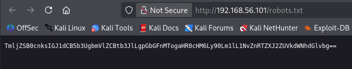
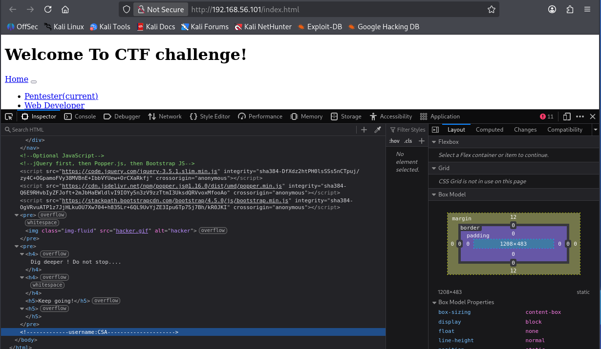
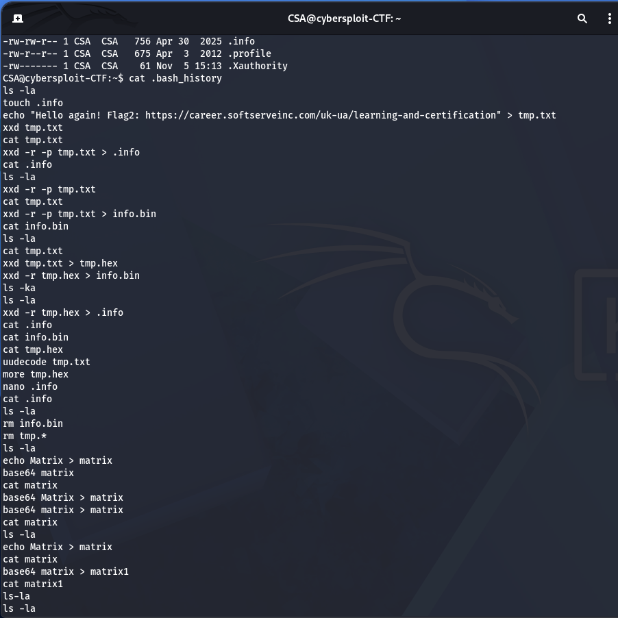
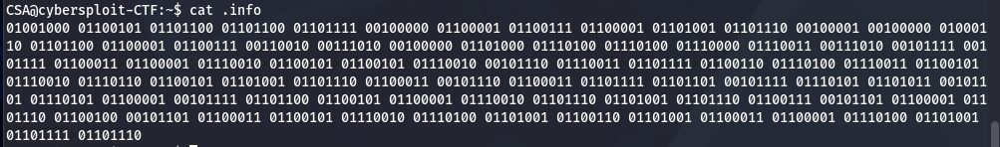
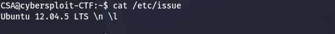
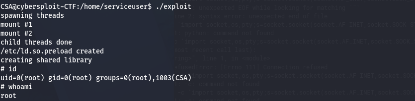
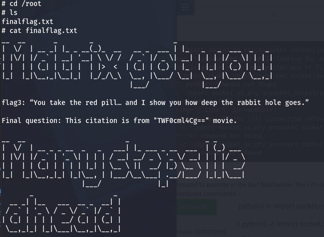

# Звіт про тестування на проникнення: CyberSploit 1 (приклад)

## Титульні дані та Executive Summary

| Поле | Значення |
| --- | --- |
| Об'єкт тестування | Віртуальна машина CyberSploit 1 (VulnHub), навчальний стенд |
| Замовник | Niko Lazur |
| Виконавець | Niko Lazur |
| Тип тесту | Black box (відомий лише діапазон мережі) |
| Період тестування | 04.11.2026 – 04.11.2026 |
| Версія звіту | 1.0 |
| Гриф | Для навчального використання |

Загальний рівень ризику — **критичний**: неавторизований зловмисник із мережі отримує повний контроль (root) над сервером за кілька кроків, використовуючи лише відкриті дані та публічний експлойт.

Мета тесту — перевірити, чи може зовнішній порушник отримати root-доступ до цільової машини. Мету досягнуто: отримано root-доступ і прочитано всі три флаги. Виявлено три знахідки: одну критичну та дві високі.

| Критичність | Кількість |
| --- | --- |
| Критична | 1 |
| Висока | 2 |
| Середня | 0 |
| Низька | 0 |

Ключові рекомендації для керівництва:

1. Прибрати облікові дані й службові підказки з публічних сторінок та файлів (HTML-коментарі, robots.txt).
2. Вимкнути парольну автентифікацію по SSH, перейти на ключі та MFA.
3. Замінити застарілу ОС (Ubuntu 12.04.5) на підтримувану версію та налаштувати регулярне оновлення.

## Область тестування та обмеження

Тестування обмежено однією віртуальною машиною в ізольованій лабораторній мережі; атакуюча машина — ParrotOS, середовище віртуалізації — Oracle VirtualBox.

| Параметр | Значення |
| --- | --- |
| Мережа, що сканувалась | 192.168.56.0/24 |
| Цільовий хост | 192.168.56.101 |
| Атакуюча машина | Kali Linux (VirtualBox) |
| Дозволені дії | Сканування, перебір директорій, автентифікація з отриманими даними, локальне підвищення привілеїв |
| Заборонені дії | Атаки на відмову в обслуговуванні, дії поза лабораторною мережею |
| Авторизація | Навчальне завдання; тестування проводиться виключно на власному стенді |

Обмеження: тест виконувався в одному сеансі, без перевірки стійкості до виявлення (немає SIEM/IDS), а результати стосуються лише стану образу на момент тестування.

## Методологія та інструменти

Тестування виконано за фазами стандарту PTES (Penetration Testing Execution Standard); оцінка критичності — за CVSS v3.1.

| Фаза PTES | Що виконано | Інструменти |
| --- | --- | --- |
| Збір інформації | Виявлення хоста та відкритих сервісів | nmap (-sV) |
| Аналіз вразливостей | Пошук прихованого вмісту, аналіз HTML-коду, визначення версії ОС і ядра | dirb, браузер, uname, /etc/issue |
| Експлуатація | Вхід по SSH з отриманими обліковими даними | ssh |
| Post-exploitation | Підвищення привілеїв до root, збір флагів | Exploit-DB (37292), scp, gcc |
| Звітність | Складання цього звіту | 08.11.2026 |

Для декодування знайдених даних використано утиліту base64 та binary-to-text декодер.

## Підсумок знахідок

Виявлено три знахідки, які разом утворюють ланцюг від анонімного доступу до root.

| ID | Назва | Критичність | CVSS v3.1 | Актив | Статус |
| --- | --- | --- | --- | --- | --- |
| F-01 | Розкриття облікових даних у відкритому вебконтенті | Висока | 7.5 | 192.168.56.101:80 | Відкрито |
| F-02 | Слабка автентифікація SSH (пароль із публічного джерела) | Критична | 9.8 | 192.168.56.101:22 | Відкрито |
| F-03 | Локальне підвищення привілеїв через застарілу ОС і ядро | Висока | 7.8 | 192.168.56.101 (ОС) | Відкрито |

## Хронологія та шлях атаки

Корінь компрометації — публічно доступні дані, з яких зловмисник отримав і логін, і пароль; далі вразливе ядро дало змогу піднятися до root. Часові мітки кожного кроку слід додати зі своїх нотаток.

1. **Розвідка.** Скан мережі `nmap 192.168.88.0/24 -sV` виявив хост із відкритими портами 22 (SSH) і 80 (HTTP). 12:30
2. **Пошук прихованого вмісту.** `dirb` знайшов файл `/robots.txt` із закодованим рядком; після декодування base64 отримано перший флаг (F-01). 12:32
3. **Аналіз HTML.** У коментарі до коду головної сторінки знайдено ім'я користувача `CSA` (F-01). 12:35
4. **Початковий доступ.** Перший флаг використано як пароль, вхід по SSH успішний (F-02). У домашній директорії знайдено `flag2.txt` (бінарний код, після декодування — другий флаг). 12:37
5. **Розвідка всередині системи.** `uname -a` і `cat /etc/issue` показали Ubuntu 12.04.5 та ядро Linux 3.13.0 (F-03). 12:39
6. **Підвищення привілеїв.** Експлойт 37292 з Exploit-DB скомпільовано на цілі (`gcc`) і запущено; отримано root. 12:50
7. **Мета досягнута.** У `/root/` прочитано `finalflag.txt`. 12:53

## Детальний опис знахідок

### F-01. Розкриття облікових даних у відкритому вебконтенті

**Критичність:** Висока | **CVSS v3.1:** 7.5 (AV:N/AC:L/PR:N/UI:N/S:U/C:H/I:N/A:N) **Уражений актив:** 192.168.56.101:80

**Опис.** Файл `/robots.txt` містить закодований рядком base64 перший флаг, а HTML-коментар на головній сторінці — ім'я користувача `CSA`. Жодних засобів захисту контенту (авторизація, маскування) немає.

**Вплив.** Зловмисник отримує частину облікових даних (логін) та підказку щодо пароля без жодної автентифікації.

**Кроки відтворення:**

1. `dirb http://192.168.56.101` → знайдено `/robots.txt`
2. Відкрити файл, скопіювати закодований рядок
3. `echo "<base64-рядок>" | base64 --decode` → отримано `https://t.me/SoftServeEducation`
4. Переглянути вихідний HTML-код головної сторінки → знайдено коментар `Username: CSA`

**Докази:** , 

**Рекомендації:** прибрати службові коментарі та тестові дані з production-коду; не публікувати облікові дані чи їх частини у статичних файлах; провести перегляд вихідного коду перед публікацією.

**Посилання:** CWE-200 ([Exposure of Sensitive Information](https://cwe.mitre.org/data/definitions/200.html))

---

### F-02. Слабка автентифікація SSH (пароль із публічного джерела)

**Критичність:** Критична | **CVSS v3.1:** 9.8 (AV:N/AC:L/PR:N/UI:N/S:U/C:H/I:H/A:H) **Уражений актив:** 192.168.88.X:22 (користувач itsskv)

**Опис.** SSH-сервіс дозволяє парольну автентифікацію без обмеження спроб і без MFA. Пароль облікового запису `CSA` збігається зі значенням першого флага, отриманим з публічно доступного файлу.

**Вплив.** Повний неавторизований доступ до облікового запису користувача в системі, що є точкою входу для подальшої ескалації привілеїв.

**Кроки відтворення:**

1. `ssh CSA@192.168.56.101`
2. Увести як пароль значення `https://t.me/SoftServeEducation`
3. Отримано інтерактивну сесію shell
4. У домашній директорії знайдено `flag2.txt`, вміст — бінарний код; після декодування отримано другий флаг

**Докази:** , 

**Рекомендації:** вимкнути парольну автентифікацію по SSH (`PasswordAuthentication no`), перейти на автентифікацію за ключами, додати MFA та обмеження кількості спроб (fail2ban), не використовувати публічно доступні дані як облікові.

**Посилання:** CWE-521 (Weak Password Requirements), OWASP Top 10 A07:2021

---

### F-03. Локальне підвищення привілеїв через застарілу ОС і ядро

**Критичність:** Висока | **CVSS v3.1:** 7.8 (AV:L/AC:L/PR:L/UI:N/S:U/C:H/I:H/A:H) **Уражений актив:** 192.168.56.101 (Ubuntu 12.04.5, ядро Linux 3.13.0)

**Опис.** Система працює на знятій з підтримки версії Ubuntu з застарілим ядром, вразливим до публічного експлойта підвищення привілеїв (Exploit-DB ID 37292).

**Вплив.** Будь-який користувач з доступом до shell може підвищити привілеї до root, отримавши повний контроль над системою.

**Кроки відтворення:**

1. `uname -a` та `cat /etc/issue` → підтверджено версію ОС і ядра
2. Знайдено відповідний експлойт у базі Exploit-DB (ID 37292)
3. Завантажено експлойт на атакуючу машину, перенесено на ціль командою `scp`
4. `gcc 37292.c -o exploit && ./exploit`
5. Отримано root-доступ, у `/root/finalflag.txt` прочитано фінальний флаг

**Докази:** , , 

**Рекомендації:** оновити ОС до підтримуваної версії з актуальними патчами ядра; впровадити регулярний цикл оновлень та сканування на вразливості; обмежити компіляцію коду (gcc) для звичайних користувачів там, де це можливо.

**Посилання:** CWE-269 (Improper Privilege Management), Exploit-DB 37292

## Рекомендації та план усунення

| № | Знахідка | Рекомендація | Пріоритет | Термін |
| --- | --- | --- | --- | --- |
| 1 | F-02 | Вимкнути парольну автентифікацію SSH, перейти на ключі + MFA | Критичний | Негайно |
| 2 | F-03 | Оновити ОС та ядро до підтримуваної версії, встановити патчі | Високий | 7 днів |
| 3 | F-01 | Прибрати облікові дані й коментарі з публічного вебконтенту | Високий | 7 днів |
| 4 | Загальне | Впровадити регулярний цикл сканування на вразливості та управління патчами | Середній | 30 днів |
| 5 | Загальне | Налаштувати обмеження спроб входу (fail2ban) та журналювання автентифікації | Середній | 30 днів |

Порядок визначено за комбінацією критичності й простоти усунення: пункти 1–3 закривають безпосередній шлях до root і не потребують значних ресурсів.

## Висновки та критерії ретесту

Ціль тестування досягнута повністю: отримано root-доступ і прочитано всі три флаги. Причиною стала не одна вразливість, а ланцюг слабких місць — розкриття даних у публічному контенті, повторне використання цих даних як пароля та застаріла, неоновлювана система. Усунення лише однієї ланки (наприклад, зміна пароля) суттєво знизило б ризик, але не усунуло б шлях до root через F-03.

Ретест вважається успішним, якщо:

- `dirb` та перегляд вихідного коду сторінки не розкривають облікових даних чи їх фрагментів;
- вхід по SSH паролем неможливий (лише ключі, за наявності MFA);
- `uname -a` показує підтримувану версію ядра, а експлойт 37292 (або його аналоги для поточної версії) не спрацьовує.

Рекомендований термін повторної перевірки — після виконання пунктів 1–3 плану усунення, орієнтовно протягом 14 днів з моменту подання цього звіту.

## Додатки

### A. Використані команди

```sh
nmap 192.168.56.0/24 -sV
dirb http://192.168.56.101
echo "TWF0cml4Cg==" | base64 --decode
ssh itsskv@192.168.56.101
cat flag2.txt
uname -a
cat /etc/issue
scp 37292.c CSA@192.168.56.101:/tmp/
gcc 37292.c -o exploit
./exploit
cat /root/finalflag.txt
```

### B. Перелік інструментів

| Інструмент | Призначення |
| --- | --- |
| nmap | Сканування портів і визначення сервісів |
| dirb | Перебір прихованих директорій та файлів |
| ssh / scp | Віддалений доступ та передавання файлів |
| base64 / Burp Decoder | Декодування закодованих рядків |
| gcc | Компіляція експлойта на цільовій машині |
| Exploit-DB (ID 37292) | Джерело експлойта для підвищення привілеїв |

### C. Шкала оцінювання критичності (CVSS v3.1)

| Діапазон CVSS | Критичність |
| --- | --- |
| 9.0 – 10.0 | Критична |
| 7.0 – 8.9 | Висока |
| 4.0 – 6.9 | Середня |
| 0.1 – 3.9 | Низька |

### D. Отримані флаги

| Флаг | Значення | Спосіб отримання |
| --- | --- | --- |
| Flag 1 | `https://t.me/SoftServeEducation` | Декодування base64 вмісту robots.txt |
| Flag 2 | `https://career.softserveinc.com/uk-ua/learning-and-certification` | Декодування бінарного вмісту flag2.txt |
| Flag 3 (фінальний) | You take the red pill… and I show you how deep the rabbit hole goes. | Прочитано з /root/finalflag.txt після отримання root |
